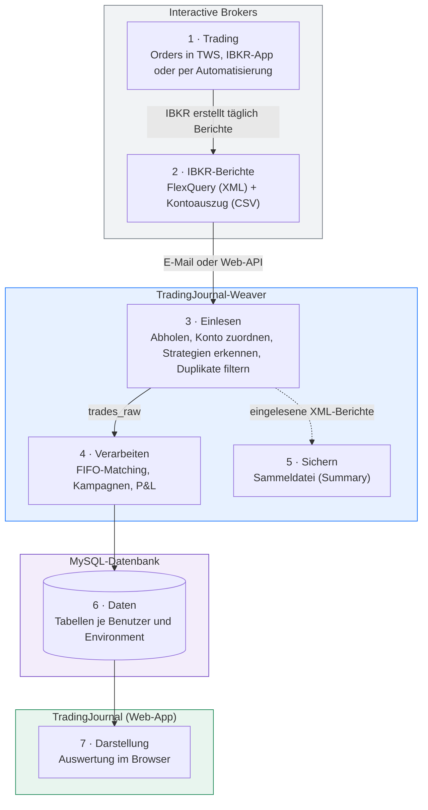
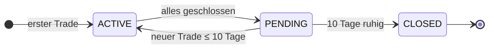

# Überblick — vom Trade bis zur Auswertung

Dieses Kapitel beschreibt den Weg eines Trades: von der Order bei Interactive Brokers (IBKR) bis zur Zahl im
TradingJournal. Wer den Ablauf einmal verstanden hat, kann später auch einschätzen, *warum* ein Trade
noch nicht sichtbar ist, warum eine Position offen bleibt oder woher eine Kennzahl stammt.

Beteiligt sind zwei Programme, die sich eine MySQL-Datenbank teilen:

- **TradingJournal-Weaver** (Python) holt die Berichte von IBKR, liest sie ein und rechnet sie aus. Es *schreibt*
  die Trading-Daten.
- **TradingJournal** (Laravel-Web-App) zeigt diese Daten an. Es *liest* die Trading-Daten und
  schreibt nur seine eigenen Einträge (Trade Log, Psychologie, Benutzer).



Die Farben zeigen, wer zuständig ist: **Interactive Brokers** (grau) erzeugt die Daten,
**TradingJournal-Weaver** (blau, Python) holt, liest und verarbeitet sie, die **MySQL-Datenbank**
(violett) speichert sie, und das **TradingJournal** (grün, Web-App) stellt sie dar. Die Nummern
entsprechen den Abschnitten dieses Kapitels.

> [!NOTE]
> Das Journal ist **kein Echtzeit-Tool**. IBKR erstellt die Berichte erst nach Handelsschluss;
> zwischen Trade und Anzeige liegen deshalb typischerweise ein bis zwei Tage.

---

## 1. Trading bei IBKR

Gehandelt wird wie gewohnt — in der Trader Workstation (TWS), in der IBKR-App oder über ein
automatisiertes Handelssystem. Für das Journal muss **nichts** am Handel geändert werden.

- **Nur lesender Zugriff:** Das Journal verbindet sich nie mit der Handelsschnittstelle und kann
  keine Orders auslösen. Es verarbeitet ausschließlich Berichte, die IBKR ohnehin erstellt.
- **Mehrere Konten:** Jedes IBKR-Konto (z. B. Echtgeld, Paper, ein separates Konto für
  automatisierten Handel) wird später genau einem **Environment** zugeordnet. So bleiben
  Echtgeld, Übungs- und Testdaten strikt getrennt:

| Environment   | Typische Verwendung                                   |
| ------------- | ----------------------------------------------------- |
| `MONEY`       | Echtgeld-Konto, manueller Handel                      |
| `PAPER`       | Paper-Trading-Konto (Simulation)                      |
| `AUTOM_MONEY` | Echtgeld-Konto für automatisierten Handel             |
| `AUTOM_PAPER` | Paper-Konto für automatisierten Handel                |
| `TEST`        | Ausprobieren und Testen, ohne echte Daten zu berühren |

## 2. IBKR liefert die Daten: FlexQuery und Kontoauszug

IBKR bietet mit **Flex Queries** frei konfigurierbare Berichte an, die automatisch erstellt und per
E-Mail zugestellt oder über eine Web-Schnittstelle abgerufen werden können. Das Journal nutzt
drei Arten von Berichten:

| Bericht                              | Format | Zustellung                   | Inhalt                                                                     | Wofür                                                   |
| ------------------------------------ | ------ | ---------------------------- | -------------------------------------------------------------------------- | ------------------------------------------------------- |
| **FlexQuery**                        | XML    | täglich per E-Mail           | Trades, Verfall/Ausübung/Zuteilung von Optionen, Kapitalmaßnahmen (Splits) | Hauptquelle für alle Trades                             |
| **FlexQuery per Web-API**            | XML    | auf Abruf (Token + Query-ID) | Trades, Verfall/Ausübung/Zuteilung von Optionen, Kapitalmaßnahmen (Splits) | Zweiter, unabhängiger Kanal — falls eine Mail ausbleibt |
| **Kontoauszug** (Activity Statement) | CSV    | täglich per E-Mail           | Kontostand, Cash, Tagesperformance (TWRR)                                  | Kontoverlauf und Rendite auf dem Dashboard              |

> [!WARNING]
> Der Kontoauszug wird nur per E-Mail zugestellt. Es gibt keine Möglichkeit, ihn per Abruf (Web-API) anzufordern.

Für **jedes IBKR-Konto**, dessen Daten verarbeitet werden sollen, wird eine eigene Flex Query
(und ein eigener Kontoauszug) eingerichtet. Welche Einstellungen dafür nötig sind, zeigt Schritt
für Schritt das Kapitel [IBKR einrichten](20-ibkr-einrichten.md). Wie eine Flex Query technisch
aufgebaut ist und welche Felder der Import daraus liest, beschreibt das technische Handbuch
([Aufbau einer Flex Query](../technik/20-aufbau-flexquery.md)).

## 3. Einlesen: Abholen und Import

Das Einlesen erledigt ein einziger Befehl in `TradingJournal-Weaver`, der alle Schritte nacheinander ausführt
und typischerweise einmal täglich automatisch läuft (Windows-Aufgabenplanung):

```
python run_pipeline.py
```

**Schritt 1 — Abholen**

- `fetch_emails` meldet sich per IMAP am eingetragenen Postfach an, sucht ausschließlich Mails von IBKR. Die Dateianhänge (XML) werden am Rechner lokal im Verzeichnis `C:\Trade_XML\incoming_mail\`, die Kontoauszüge (CSV) im Verzeichnis `C:\Trade_CSV\incoming\` gespeichert.
- `fetch_api` ruft — falls konfiguriert — dieselben Trades zusätzlich über die IBKR-Web-API ab und speichert sie im Verzeichnis `C:\Trade_XML\incoming_api\`.
- Dateien können auch von Hand in diese Ordner kopiert werden; der weitere Ablauf ist derselbe.

**Schritt 2 — Import**

Der Import liest jede XML-Datei und überträgt die Trades unverändert in die Datenbank (Tabellenname: `trades_raw`). Dort werden sie zu diesem Zeitpunkt als „noch nicht verarbeitet“ markiert.
Während des Einlesens passiert Folgendes:

1. **Konto zuordnen** — Anhand der letzten vier Ziffern der IBKR-Kontonummer (steht in den Daten) werden die Daten einem Benutzer und Environment zugeordnet. Unbekannte
   Konten werden mit einer Warnung übersprungen, nie „irgendwo“ einsortiert.
2. **Teilausführungen bündeln** — Wurde eine Order in mehreren Teilen ausgeführt, werden die
   Fills derselben Order (`ibOrderID`) zusammengefasst.
3. **Options-Strategien erkennen** — In der TWS ist ein Spread ein eigenes, synthetisches Finanzinstrument (Combo-Order). In den Flex Queries liefert IBKR jedoch jede Option als eigenen Trade. Das System setzt das synthetische Instrument heuristisch wieder zusammen: Beine mit gleicher Order-ID oder innerhalb von 3 Sekunden werden gruppiert und als Strategie benannt, etwa Bull Put / Bear Call Spread, Iron Condor, Straddle, Strangle, Calendar Spread oder Butterfly.
4. **Options-Ereignisse zuordnen** — Verfall, Ausübung, Zuteilung und Barausgleich (z. B. bei SPX)
   werden der passenden automatischen IBKR-Buchung zugeordnet.
5. **Währungstausch abtrennen** — Reine Devisen-Trades (z. B. EUR.USD) landen zusätzlich in der
   eigenen Datenbanktabelle `trades_fx`.
6. **Duplikate filtern** — Jeder Trade erhält eine Prüfsumme. Ist die Prüfsumme in der Datenbank noch nicht vorhanden, wird der Trade gespeichert. Kommt derselbe Trade erneut an
   (über Mail *und* Web-API, oder weil eine Datei doppelt eingelesen wird), wird er übersprungen.

Die Kontoauszüge (CSV) werden verarbeitet und es wird ein Snapshot (aktueller Wert des Depots) angelegt.

> [!TIP]
> `trades_raw` enthält die Trades genau so, wie IBKR sie geliefert hat. Bei Unklarheiten ist
> die Seite **Raw Data** (unter *Analyse*) im Journal deshalb der erste Anlaufpunkt: Steht ein Trade dort, ist er
> angekommen — fehlt er, liegt das Problem vor dem Import (Bericht, Mail, Kontozuordnung).

## 4. Verarbeiten: FIFO-Matching und Kampagnen

Der nächste Schritt arbeitet alle noch nicht verarbeiteten Trades aus der Datenbanktabelle
`trades_raw` **in zeitlicher Reihenfolge** ab und entscheidet für jeden Trade, was er bedeutet.
Dabei passieren zwei Dinge gleichzeitig: Das **FIFO-Matching** ordnet jeden Trade den offenen
Positionen zu und berechnet Gewinn und Verlust (4.1), und jede Veränderung wird als Buchung in
der **Kampagne** des Symbols festgehalten (4.2).

Jeder Trade wird in einer eigenen Datenbank-Transaktion verarbeitet: Entweder sind alle
zugehörigen Einträge geschrieben oder keiner — auch bei einem Absturz entstehen keine halben
Zustände. Alle Geldbeträge werden als exakte Dezimalzahlen gerechnet, nicht als
Gleitkommazahlen, damit sich keine Rundungsfehler aufsummieren.

### 4.1 FIFO-Matching

Wie in den IBKR-Steuerberichten wird nach *First In, First Out* gerechnet: Ein
Verkauf schließt immer zuerst die älteste offene Tranche. Dadurch stimmen Gewinn und Verlust mit
den offiziellen IBKR-Auswertungen überein. Eine **Tranche** ist dabei ein einzelner Kauf (bzw.
bei Short-Positionen ein einzelner Verkauf) mit eigenem Einstandspreis und Datum.

Beispiel mit vier Trades in AAPL (Gewinne brutto, ohne Kommission):

| Datum | Trade                | Was passiert                                                                          | Offen danach            |
| ----- | -------------------- | ------------------------------------------------------------------------------------- | ----------------------- |
| 03.03 | Kauf 100 zu 150 $    | neue Tranche A                                                                        | A: 100 zu 150 $         |
| 10.03 | Kauf 50 zu 160 $     | neue Tranche B, Tranche A bleibt unverändert                                          | A: 100, B: 50 zu 160 $  |
| 20.03 | Verkauf 120 zu 170 $ | schließt zuerst A komplett (100 Stück, +2.000 $), dann 20 Stück von B (+200 $)        | B: 30 zu 160 $          |
| 25.03 | Verkauf 80 zu 165 $  | schließt den Rest von B (30 Stück, +150 $), die übrigen 50 Stück eröffnen eine Short-Position | Short 50 zu 165 $ |

Jeder geschlossene Teil wird ein eigener **abgeschlossener Trade** mit eigenem Einstandspreis,
eigener Haltedauer und eigenem P&L. Der Verkauf vom 20.03. erscheint unter *Geschlossene
Positionen* deshalb als zwei Zeilen (100 und 20 Stück). Offene Tranchen stehen in der
Datenbanktabelle `trades_open`, abgeschlossene Trades in `trades_close`.

Daneben gibt es einige Sonderfälle:

- **Aktiensplit** — Menge und Einstandspreis aller offenen Tranchen werden angepasst, es entsteht
  kein abgeschlossener Trade.
- **Verfall, Ausübung, Zuteilung** — Die Option wird als abgeschlossener Trade mit der
  passenden Abschlussart gespeichert (*Expired*, *Assigned*, *CashSettled*). Bei einer Zuteilung
  kommen die gelieferten Aktien als neue Tranche hinzu.
- **Devisentausch** (z. B. EUR.USD) — kein FIFO, eigene Übersicht.

Wie die Tabellen dabei im Einzelnen geschrieben werden, beschreibt das technische Handbuch
([Architektur und Pipeline](../technik/10-architektur-und-pipeline.md), Abschnitt „FIFO-Matching: Die Fälle“).

Für jeden abgeschlossenen Trade werden **P&L**, **ROI** (bezogen auf das eingesetzte Kapital) und
**Haltedauer** berechnet, jeweils in Handelswährung und umgerechnet in Euro.

> [!IMPORTANT]
> Alle gespeicherten P&L-Werte sind **brutto**, also ohne Kommissionen. Die Kommissionen werden
> separat gespeichert; das Journal zeigt deshalb überall Brutto- und Netto-P&L
> (Netto = Brutto + Kommission, da IBKR Kommissionen negativ ausweist).

### 4.2 Kampagnen und Ledger

FIFO beantwortet die Frage „Was hat dieser einzelne Trade gebracht?“. Viele Strategien bestehen
aber aus einer Kette von Trades, die nur zusammen Sinn ergeben. Deshalb werden alle Trades eines
Symbols, die zeitlich zusammenhängen, zu einer **Kampagne** gebündelt — Aktien und Optionen auf
dasselbe Underlying gehören dabei zur selben Kampagne. So erscheint z. B. eine Wheel-Strategie
(Put verkauft → Zuteilung → Covered Call → neuer Put) als **eine** zusammenhängende Position
statt als viele Einzeltrades.

**Lebenslauf einer Kampagne** — Der erste Trade in einem Symbol eröffnet eine Kampagne
(*ACTIVE*). Ist nichts mehr offen, wartet sie 10 Tage (*PENDING*): Kommt in dieser Zeit ein neuer
Trade, läuft dieselbe Kampagne weiter; sonst wird sie abgeschlossen (*CLOSED*), und der nächste
Trade in dem Symbol beginnt eine neue.



**Das Ledger: die Buchhaltung jeder Kampagne** — Für jede Kampagne wird ein *Ledger* geführt,
ein Kassenbuch im Sinne der Buchhaltung. Jede Veränderung erzeugt darin eine eigene Buchung:
Eröffnen, (teilweises) Schließen, Verfall, Ausübung oder Zuteilung einer Option, Barausgleich,
Aktiensplit. Eine FIFO-Teilung wie am 20.03. im Beispiel oben ergibt zwei Buchungen, eine je
Tranche. Jede Buchung enthält:

- die **Art** der Buchung (z. B. `OPT_PUT_SELL` = Put verkauft, `OPTION_EXPIRATION` = Option
  verfallen) und die **Mengenänderung**,
- den **Cashflow** (Geldbewegung auf dem Konto), die **Kommission** und — bei Schließungen — den
  **realisierten P&L**,
- **laufende Summen**: aufgelaufener P&L, Kommissionen und Erlöse (Proceeds) der Kampagne bis zu
  dieser Buchung,
- Währung, Wechselkurs und die Beträge in Euro,
- einen Verweis auf den Ursprungs-Trade. Zusammengehörige Buchungen, etwa die zugeteilte Option
  und die dadurch gelieferten Aktien, sind miteinander verknüpft.

Beispiel einer Wheel-Kampagne (vereinfacht, ohne Kommissionen):

| Buchung                        | Art                 | Menge     | Cashflow   | P&L     | P&L kumuliert |
| ------------------------------ | ------------------- | --------- | ---------- | ------- | ------------- |
| Put XYZ 50 verkauft            | `OPT_PUT_SELL`      | −1 Option | +150 $     | —       | 0 $           |
| Put zugeteilt                  | `OPTION_EXERCISE`   | +1 Option | —          | +150 $  | 150 $         |
| 100 Aktien zu 50 $ eingebucht  | `STK_BUY`           | +100 Stk. | −5.000 $   | —       | 150 $         |
| Call XYZ 55 verkauft           | `OPT_CALL_SELL`     | −1 Option | +80 $      | —       | 150 $         |
| Call verfallen                 | `OPTION_EXPIRATION` | +1 Option | —          | +80 $   | 230 $         |

Buchungen werden im laufenden Betrieb nur angehängt, nie nachträglich verändert. Aus dem
Ledger entstehen im Journal der **P&L-Verlauf**, die **Tages-Übersicht** und die
**Transaktions-Historie** jeder Kampagne, außerdem die Auswertungen unter *Stats* und
*Aktivität*. Auch der Bestand einer Kampagne (Spalte *Bestand* in der Transaktions-Historie)
ergibt sich aus der Summe aller Mengenänderungen.

## 5. Sichern: die Sammeldatei (Summary)

**Wann?** Als letzter Schritt jedes Pipeline-Laufs, also direkt nach der Verarbeitung und
damit normalerweise einmal täglich — für jeden Benutzer und jedes Environment außer `TEST`.

**Was passiert?** Nach dem Import liegen die eingelesenen XML-Berichte (aus Mail und Web-API)
im Ordner `C:\Trade_XML\<environment>\<benutzer>\processed\`. Der Schritt `summary` nimmt
die dort neu hinzugekommenen Berichte und hängt ihre Tagesberichte an eine **Sammeldatei** an:

```
C:\Trade_XML\<environment>\summary_<präfix><environment>.xml
```

Jeder Berichtstag wird nur einmal aufgenommen, leere Berichte (Tage ohne Trades) werden
übersprungen, und die Datei bleibt nach Datum sortiert. So wächst über die Zeit eine
vollständige Historie aller Trades in einer einzigen Datei.

**Wozu?** Muss die Datenbank einmal neu aufgebaut werden — etwa nach einem Fehler oder wenn
eine neue Version anders rechnet —, werden aus der Sammeldatei alle Trades erneut eingelesen
und verarbeitet, ohne dass die ursprünglichen Mails noch vorhanden sein müssen. Wie das geht,
beschreibt das technische Handbuch ([Befehlsreferenz](../technik/30-befehlsreferenz.md)).

> [!IMPORTANT]
> Die Sammeldatei enthält nur die **Trades** aus den Flex Queries, keine Kontoauszüge (CSV).
> Sie ist die wichtigste Datei für eine Datensicherung: Wer sie aufbewahrt, kann seine
> Trade-Historie jederzeit wiederherstellen.

## 6. Welche Daten entstehen

Die Daten sind auf zwei Ebenen getrennt: **Jedes Environment hat eine eigene Datenbank**, und
**jeder Benutzer hat darin seine eigenen Tabellen**, erkennbar am Präfix vor dem Tabellennamen.
Ein Beispiel mit zwei Benutzern: Anna handelt mit Echtgeld und auf einem Paper-Konto, Tom nur
auf Paper.

```
MySQL-Server
│
├── ibkr_laravel                 Web-App: Benutzerkonten (gemeinsam für alle)
│   └── users                      Anna → Präfix anna_,  Tom → Präfix tom_
│
├── ibkr_money                   Environment MONEY
│   ├── anna_trades_raw
│   ├── anna_trades_close
│   ├── anna_campaign_ledger
│   └── … alle weiteren Tabellen mit anna_
│
├── ibkr_paper                   Environment PAPER
│   ├── anna_trades_raw
│   ├── anna_…
│   ├── tom_trades_raw
│   └── tom_…
│
├── ibkr_test                    Environment TEST
├── ibkr_autom_money             Environment AUTOM_MONEY
└── ibkr_autom_paper             Environment AUTOM_PAPER
```

- Tabellen entstehen nur dort, wo sie eingerichtet werden: Tom hat in `ibkr_money` keine
  Tabellen, weil er kein Echtgeld-Konto verbindet (eingerichtet im Kapitel
  [TradingJournal-Weaver installieren](40-weaver-installieren.md), Schritt „Datenbank-Tabellen
  anlegen“).
- Das Präfix muss an zwei Stellen gleich sein: in `users.toml` von TradingJournal-Weaver
  (dorthin schreibt der Import) und beim Benutzerkonto der Web-App (von dort liest das Journal).
- Beim Anmelden bestimmt das Benutzerkonto das Präfix, der **Environment-Schalter** wählt die
  Datenbank. Anna sieht in *PAPER* also `ibkr_paper` mit den Tabellen `anna_…`, nicht die von
  Tom. Einzige Ausnahme: Ein Administrator kann bewusst auf einen anderen
  Benutzer wechseln — aber nur, wenn die Web-App im lokalen Modus läuft (`APP_ENV=local`).

Je Benutzer und Environment gibt es folgende Tabellen:

| Tabelle             | Inhalt                                                          | Entsteht in              |
| ------------------- | --------------------------------------------------------------- | ------------------------ |
| `trades_raw`        | Trades genau so, wie IBKR sie geliefert hat                     | Import                   |
| `trades_fx`         | Devisentausch-Trades                                            | Import                   |
| `symbols`           | Stammdaten der Instrumente (Symbol, ISIN, Kontraktdaten)        | Import                   |
| `account_snapshots` | Tageswerte des Kontos: Nettovermögen, Cash, Tagesrendite        | Import (Kontoauszug-CSV) |
| `trades_open`       | Offene Positionen als einzelne FIFO-Tranchen                    | Verarbeitung             |
| `trades_close`      | Abgeschlossene Trades mit P&L, ROI, Haltedauer und Abschlussart | Verarbeitung             |
| `trading_campaigns` | Kampagnen je Symbol mit Status ACTIVE / PENDING / CLOSED        | Verarbeitung             |
| `campaign_ledger`   | Jede Buchung einer Kampagne mit laufendem P&L                   | Verarbeitung             |

Die Tabellen oben schreibt ausschließlich TradingJournal-Weaver; die Web-App liest sie nur. Die
folgenden Tabellen gehören genauso jedem Benutzer und Environment einzeln (z. B.
`anna_trade_planner` in `ibkr_paper`). Der Unterschied: Ihr Inhalt stammt nicht von IBKR,
sondern aus den eigenen Eingaben — es sind die **einzigen Tabellen, die du selbst in der Web-App
anlegst, änderst und löschst**:

| Tabelle                               | Inhalt                                                            |
| ------------------------------------- | ----------------------------------------------------------------- |
| `trade_planner`, `trade_planner_legs` | Trade Log: geplante und reflektierte Entscheidungen               |
| `psychology_*`                        | Psychologie-Modul: Regelwerke, Journal-Einträge, Regel-Auswertung |

## 7. Darstellung im TradingJournal

Das TradingJournal liest die Tabellen des angemeldeten Benutzers im gewählten Environment. Der
**Environment-Schalter** oben in der Navigation wählt also die Datenbank; der Benutzer-Login
bestimmt, welche Tabellen (Präfix) gelesen werden. Neue Daten sind sichtbar, sobald die Pipeline
gelaufen ist — ein Neuladen der Seite genügt.

| Bereich                                         | Zeigt                                                                | Datenquelle                                        |
| ----------------------------------------------- | -------------------------------------------------------------------- | -------------------------------------------------- |
| **Dashboard**                                   | Kennzahlen (P&L, Profit Factor, Max Drawdown, Rendite), Kontoverlauf | `trades_close`, `trades_open`, `account_snapshots` |
| **Aktien / Optionen → Offene Positionen**       | aktueller Bestand je Tranche                                         | `trades_open`                                      |
| **Aktien / Optionen → Geschlossene Positionen** | abgeschlossene Trades mit P&L, ROI, Haltedauer                       | `trades_close`                                     |
| **Spreads** (Vertical Spreads, Iron Condors)    | erkannte Options-Strategien mit allen Beinen                         | `trades_open`, `trades_close`                      |
| **Kampagnen**                                   | Kampagnen-Liste und Detailseite mit P&L-Verlauf und Ledger           | `trading_campaigns`, `campaign_ledger`             |
| **Analyse → Symbole**                           | alle Kampagnen eines Symbols im Überblick                            | `trading_campaigns`, `campaign_ledger`             |
| **Analyse → Stats / Aktivität**                 | Auswertungen je Zeitraum, chronologische Buchungsliste               | `campaign_ledger`                                  |
| **Analyse → FX-Trades**                         | Währungstausch-Trades                                                | `trades_fx`                                        |
| **Analyse → Raw Data**                          | Trades im Originalzustand von IBKR                                   | `trades_raw`                                       |
| **Log**                                         | eigene Planung und Reflexion, verknüpfbar mit Kampagnen              | `trade_planner` + Kampagnen                        |
| **Psychologie**                                 | Regelwerke und Regel-Einhaltung je Trade                             | `psychology_*` + Trades                            |

> [!TIP]
> Die Detailseiten einzelner Trades verlinken auf den zugehörigen Eintrag in **Raw Data**. So
> lässt sich ein abgeschlossener Trade bis zu den Originaldaten aus dem IBKR-Bericht
> zurückverfolgen.
