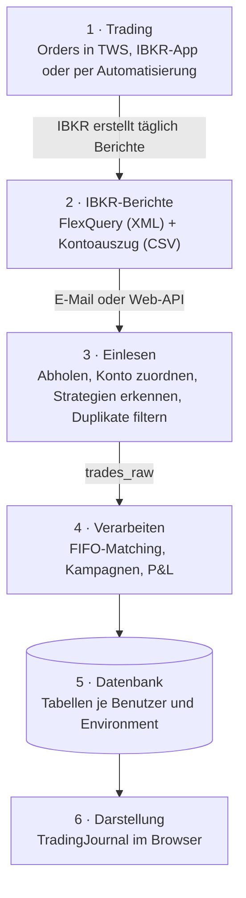
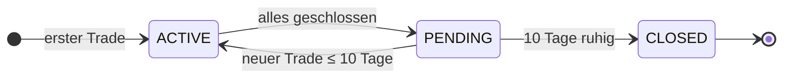

# Überblick — vom Trade bis zur Auswertung

Dieses Kapitel beschreibt den Weg eines Trades: von der Order bei Interactive Brokers (IBKR) bis zur Zahl im
TradingJournal. Wer den Ablauf einmal verstanden hat, kann später auch einschätzen, *warum* ein Trade
noch nicht sichtbar ist, warum eine Position offen bleibt oder woher eine Kennzahl stammt.

Beteiligt sind zwei Programme, die sich eine MySQL-Datenbank teilen:

- **TradingJournal-Weaver** (Python) holt die Berichte von IBKR, liest sie ein und rechnet sie aus. Es *schreibt*
  die Trading-Daten.
- **TradingJournal** (Laravel-Web-App) zeigt diese Daten an. Es *liest* die Trading-Daten und
  schreibt nur seine eigenen Einträge (Trade Log, Psychologie, Benutzer).



> [!NOTE]
> Das Journal ist **kein Echtzeit-Tool**. IBKR erstellt die Berichte erst nach Handelsschluss;
> zwischen Trade und Anzeige liegen deshalb typischerweise ein bis zwei Tage.

---

## 1. Trading bei IBKR

Gehandelt wird wie gewohnt — in der Trader Workstation (TWS), in der IBKR-App oder über ein
automatisiertes Handelssystem. Für das Journal muss **nichts** am Handel geändert werden.

- **Nur lesender Zugriff:** Das Journal verbindet sich nie mit der Handelsschnittstelle und kann
  keine Orders auslösen. Es verarbeitet ausschließlich Berichte, die IBKR ohnehin erstellt.
- **Mehrere Konten:** Jedes IBKR-Konto (z. B. Echtgeld, Paper, ein separates Konto für
  automatisierten Handel) wird später genau einem **Environment** zugeordnet. So bleiben
  Echtgeld, Übungs- und Testdaten strikt getrennt:

| Environment   | Typische Verwendung                                   |
| ------------- | ----------------------------------------------------- |
| `MONEY`       | Echtgeld-Konto, manueller Handel                      |
| `PAPER`       | Paper-Trading-Konto (Simulation)                      |
| `AUTOM_MONEY` | Echtgeld-Konto für automatisierten Handel             |
| `AUTOM_PAPER` | Paper-Konto für automatisierten Handel                |
| `TEST`        | Ausprobieren und Testen, ohne echte Daten zu berühren |

## 2. IBKR liefert die Daten: FlexQuery und Kontoauszug

IBKR bietet mit **Flex Queries** frei konfigurierbare Berichte an, die automatisch erstellt und per
E-Mail zugestellt oder über eine Web-Schnittstelle abgerufen werden können. Das Journal nutzt
drei Arten von Berichten:

| Bericht                              | Format | Zustellung                   | Inhalt                                                                     | Wofür                                                   |
| ------------------------------------ | ------ | ---------------------------- | -------------------------------------------------------------------------- | ------------------------------------------------------- |
| **FlexQuery**                        | XML    | täglich per E-Mail           | Trades, Verfall/Ausübung/Zuteilung von Optionen, Kapitalmaßnahmen (Splits) | Hauptquelle für alle Trades                             |
| **FlexQuery per Web-API**            | XML    | auf Abruf (Token + Query-ID) | Trades, Verfall/Ausübung/Zuteilung von Optionen, Kapitalmaßnahmen (Splits) | Zweiter, unabhängiger Kanal — falls eine Mail ausbleibt |
| **Kontoauszug** (Activity Statement) | CSV    | täglich per E-Mail           | Kontostand, Cash, Tagesperformance (TWRR)                                  | Kontoverlauf und Rendite auf dem Dashboard              |

> [!WARNING]
> Der Kontoauszug wird nur per E-Mail zugestellt. Es gibt keine Möglichkeit, ihn per Abruf (Web-API) anzufordern.

Für **jedes IBKR-Konto**, dessen Daten verarbeitet werden sollen, wird eine eigene Flex Query
(und ein eigener Kontoauszug) eingerichtet. Welche Einstellungen dafür nötig sind, zeigt Schritt
für Schritt das Kapitel [IBKR einrichten](20-ibkr-einrichten.md). Wie eine Flex Query technisch
aufgebaut ist und welche Felder der Import daraus liest, beschreibt das technische Handbuch
([Aufbau einer Flex Query](../technik/20-aufbau-flexquery.md)).

## 3. Einlesen: Abholen und Import

Das Einlesen erledigt ein einziger Befehl in `TradingJournal-Weaver`, der alle Schritte nacheinander ausführt
und typischerweise einmal täglich automatisch läuft (Windows-Aufgabenplanung oder Cronjob):

```
python run_pipeline.py
```

**Schritt 1 — Abholen**

- `fetch_emails` meldet sich per IMAP am eingetragenen Postfach an, sucht ausschließlich Mails
  vom IBKR-Absender `donotreply@interactivebrokers.com` und speichert die Anhänge:
  XML-Berichte nach `C:\Trade_XML\incoming_mail\`, Kontoauszüge (CSV) nach `C:\Trade_CSV\incoming\`.
- `fetch_api` ruft — falls konfiguriert — dieselben Trades zusätzlich über die IBKR-Web-API ab und
  legt sie nach `C:\Trade_XML\incoming_api\`.
- Dateien können auch von Hand in diese Ordner kopiert werden; der weitere Ablauf ist derselbe.

**Schritt 2 — Import**

Der Import liest jede XML-Datei und überträgt die Trades unverändert in die Tabelle `trades_raw`.
Dabei passiert Folgendes:

1. **Konto zuordnen** — Anhand der letzten vier Ziffern der IBKR-Kontonummer wird in der Datei
   `accounts.toml` nachgesehen, zu welchem Benutzer und Environment die Daten gehören. Unbekannte
   Konten werden mit einer Warnung übersprungen, nie „irgendwo“ einsortiert.
2. **Teilausführungen bündeln** — Wurde eine Order in mehreren Teilen ausgeführt, werden die
   Fills derselben Order (`ibOrderID`) zusammengefasst.
3. **Options-Strategien erkennen** — IBKR liefert jedes Bein eines Spreads als einzelnen Trade.
   Das System erkennt zusammengehörige Beine (gleiche Order-ID oder innerhalb von 3 Sekunden) und
   benennt die Strategie: Bull Put / Bear Call Spread, Iron Condor, Straddle, Strangle, Calendar
   Spread, Butterfly.
4. **Options-Ereignisse zuordnen** — Verfall, Ausübung, Zuteilung und Barausgleich (z. B. bei SPX)
   werden der passenden automatischen IBKR-Buchung zugeordnet.
5. **Währungstausch abtrennen** — Reine Devisen-Trades (z. B. EUR.USD) landen zusätzlich in der
   eigenen Tabelle `trades_fx`.
6. **Duplikate filtern** — Jeder Trade erhält eine Prüfsumme. Kommt derselbe Trade erneut an
   (über Mail *und* Web-API, oder weil eine Datei doppelt eingelesen wird), wird er übersprungen.

Verarbeitete Dateien werden in einen `processed`-Ordner verschoben. Parallel liest der Schritt
`snapshot_csv` die Kontoauszüge (CSV) und legt je Tag einen Eintrag in `account_snapshots` an.

> [!TIP]
> `trades_raw` enthält die Trades genau so, wie IBKR sie geliefert hat. Bei Unklarheiten ist
> die Seite **Raw Data** (unter *Analyse*) im Journal deshalb der erste Anlaufpunkt: Steht ein Trade dort, ist er
> angekommen — fehlt er, liegt das Problem vor dem Import (Bericht, Mail, Kontozuordnung).

## 4. Verarbeiten: FIFO-Matching und Kampagnen

Der Schritt `process` arbeitet alle noch nicht verarbeiteten Einträge aus `trades_raw` **in
zeitlicher Reihenfolge** ab und entscheidet für jeden Trade, was er bedeutet.

**FIFO-Matching** — Wie in den IBKR-Steuerberichten wird nach *First In, First Out* gerechnet: Ein
Verkauf schließt immer zuerst die älteste offene Tranche. Dadurch stimmen Gewinn und Verlust mit
den offiziellen IBKR-Auswertungen überein.

| Situation             | Beispiel                   | Ergebnis                                                      |
| --------------------- | -------------------------- | ------------------------------------------------------------- |
| Position aufbauen     | Bestand 100 AAPL, Kauf 50  | neue offene Tranche in `trades_open`                          |
| Teilweise schließen   | Bestand 100, Verkauf 60    | 60 Stück → `trades_close`, 40 bleiben offen                   |
| Vollständig schließen | Bestand 100, Verkauf 100   | Tranche → `trades_close`                                      |
| Position umkehren     | Bestand 100, Verkauf 250   | 100 geschlossen, 150 als neue Short-Position                  |
| Aktiensplit           | Reverse Split 1:25         | Menge und Einstandspreis aller offenen Tranchen angepasst     |
| Verfall / Zuteilung   | Short Put verfällt wertlos | Tranche → `trades_close` mit Status *Expired* bzw. *Assigned* |
| Devisentausch         | EUR.USD                    | kein FIFO, eigene Übersicht                                   |

Für jeden abgeschlossenen Trade werden **P&L**, **ROI** (bezogen auf das eingesetzte Kapital) und
**Haltedauer** berechnet, jeweils in Handelswährung und umgerechnet in Euro.

> [!IMPORTANT]
> Alle gespeicherten P&L-Werte sind **brutto**, also ohne Kommissionen. Die Kommissionen werden
> separat gespeichert; das Journal zeigt deshalb überall Brutto- und Netto-P&L
> (Netto = Brutto + Kommission, da IBKR Kommissionen negativ ausweist).

**Kampagnen** — Alle Trades eines Symbols, die zeitlich zusammenhängen, werden zu einer *Kampagne*
gebündelt. So erscheint z. B. eine Wheel-Strategie (Put verkauft → Zuteilung → Covered Call →
neuer Put) als **eine** zusammenhängende Position statt als viele Einzeltrades.



Jede Veränderung einer Kampagne wird als Buchung im **Kampagnen-Ledger** festgehalten (z. B.
„Put verkauft“, „Option verfallen“, „Aktien verkauft“) — mit dem P&L dieser Buchung und dem bis
dahin aufgelaufenen Gesamt-P&L. Daraus entsteht später der P&L-Verlauf jeder Kampagne.

Jeder Trade wird in einer eigenen Datenbank-Transaktion verarbeitet: Entweder sind alle
zugehörigen Einträge geschrieben oder keiner — auch bei einem Absturz entstehen keine halben
Zustände. Alle Geldbeträge werden als exakte Dezimalzahlen gerechnet, nicht als
Gleitkommazahlen, damit sich keine Rundungsfehler aufsummieren.

Zum Schluss fasst der Schritt `summary` die verarbeiteten Berichte in einer Sammeldatei zusammen.
Aus ihr lässt sich ein Environment jederzeit komplett neu aufbauen, auch ohne die
ursprünglichen Mails.

## 5. Welche Daten entstehen

Jeder Benutzer hat in jedem Environment einen eigenen Satz Tabellen (erkennbar am Präfix,
z. B. `anna_trades_close`). Die Environments liegen in getrennten Datenbanken.

| Tabelle             | Inhalt                                                          | Entsteht in              |
| ------------------- | --------------------------------------------------------------- | ------------------------ |
| `trades_raw`        | Trades genau so, wie IBKR sie geliefert hat                     | Import                   |
| `trades_fx`         | Devisentausch-Trades                                            | Import                   |
| `symbols`           | Stammdaten der Instrumente (Symbol, ISIN, Kontraktdaten)        | Import                   |
| `account_snapshots` | Tageswerte des Kontos: Nettovermögen, Cash, Tagesrendite        | Import (Kontoauszug-CSV) |
| `trades_open`       | Offene Positionen als einzelne FIFO-Tranchen                    | Verarbeitung             |
| `trades_close`      | Abgeschlossene Trades mit P&L, ROI, Haltedauer und Abschlussart | Verarbeitung             |
| `trading_campaigns` | Kampagnen je Symbol mit Status ACTIVE / PENDING / CLOSED        | Verarbeitung             |
| `campaign_ledger`   | Jede Buchung einer Kampagne mit laufendem P&L                   | Verarbeitung             |

Zusätzlich gibt es Tabellen, die **nur das TradingJournal** selbst beschreibt — sie stammen nicht
von IBKR, sondern aus den eigenen Eingaben in der App:

| Tabelle                               | Inhalt                                                            |
| ------------------------------------- | ----------------------------------------------------------------- |
| `trade_planner`, `trade_planner_legs` | Trade Log: geplante und reflektierte Entscheidungen               |
| `psychology_*`                        | Psychologie-Modul: Regelwerke, Journal-Einträge, Regel-Auswertung |

## 6. Darstellung im TradingJournal

Das TradingJournal liest die Tabellen des angemeldeten Benutzers im gewählten Environment. Der
**Environment-Schalter** oben in der Navigation wählt also die Datenbank; der Benutzer-Login
bestimmt, welche Tabellen (Präfix) gelesen werden. Neue Daten sind sichtbar, sobald die Pipeline
gelaufen ist — ein Neuladen der Seite genügt.

| Bereich                                         | Zeigt                                                                | Datenquelle                                        |
| ----------------------------------------------- | -------------------------------------------------------------------- | -------------------------------------------------- |
| **Dashboard**                                   | Kennzahlen (P&L, Profit Factor, Max Drawdown, Rendite), Kontoverlauf | `trades_close`, `trades_open`, `account_snapshots` |
| **Aktien / Optionen → Offene Positionen**       | aktueller Bestand je Tranche                                         | `trades_open`                                      |
| **Aktien / Optionen → Geschlossene Positionen** | abgeschlossene Trades mit P&L, ROI, Haltedauer                       | `trades_close`                                     |
| **Spreads** (Vertical Spreads, Iron Condors)    | erkannte Options-Strategien mit allen Beinen                         | `trades_open`, `trades_close`                      |
| **Kampagnen**                                   | Kampagnen-Liste und Detailseite mit P&L-Verlauf und Ledger           | `trading_campaigns`, `campaign_ledger`             |
| **Analyse → Symbole**                           | alle Kampagnen eines Symbols im Überblick                            | `trading_campaigns`, `campaign_ledger`             |
| **Analyse → Stats / Aktivität**                 | Auswertungen je Zeitraum, chronologische Buchungsliste               | `campaign_ledger`                                  |
| **Analyse → FX-Trades**                         | Währungstausch-Trades                                                | `trades_fx`                                        |
| **Analyse → Raw Data**                          | Trades im Originalzustand von IBKR                                   | `trades_raw`                                       |
| **Log**                                         | eigene Planung und Reflexion, verknüpfbar mit Kampagnen              | `trade_planner` + Kampagnen                        |
| **Psychologie**                                 | Regelwerke und Regel-Einhaltung je Trade                             | `psychology_*` + Trades                            |

> [!TIP]
> Die Detailseiten einzelner Trades verlinken auf den zugehörigen Eintrag in **Raw Data**. So
> lässt sich ein abgeschlossener Trade bis zu den Originaldaten aus dem IBKR-Bericht
> zurückverfolgen.
