# Rundgang durch die App

Dieses Kapitel führt einmal durch alle Bereiche des TradingJournal: wofür sie gedacht sind und
welche Kennzahlen, Tabellen und Diagramme dich dort erwarten. Die Reihenfolge folgt dem Menü
links. Kurze Erklärungen zu jeder Seite gibt es auch direkt in der App unter **Hilfe**.

> [!NOTE]
> Die Bilder stammen aus der Demo-Version. Sie zeigt echte, anonymisierte Trades aus zwei
> Echtgeld- und zwei Paper-Trading-Konten. Bei dir sehen Zahlen, Symbole und Umfang natürlich
> anders aus.

---

## 1. Kopfzeile — was auf jeder Seite gilt

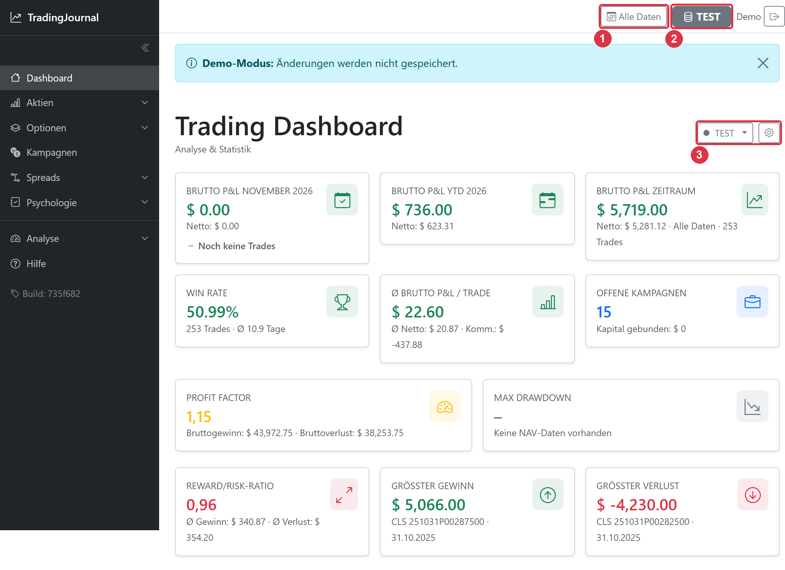

| Nr. | Element | Wofür |
|---|---|---|
| 1 | **Zeitraum** (hier „Alle Daten“) | grenzt fast jede Liste, Kennzahl und jedes Diagramm auf ein Zeitfenster ein; die Beschriftung zeigt die aktuelle Auswahl |
| 2 | **Environment-Badge** | zeigt, in welchem Datenbereich du gerade bist (`MONEY`, `PAPER`, `TEST`, `AUTOM_MONEY`, `AUTOM_PAPER`) |
| 3 | **Environment-Umschalter** und **Zahnrad** (auf dem Dashboard) | wechselt den Datenbereich bzw. wählt aus, welche Kacheln das Dashboard zeigt — siehe [Erster Start — UI-Erstkonfiguration](60-erster-start.md) |

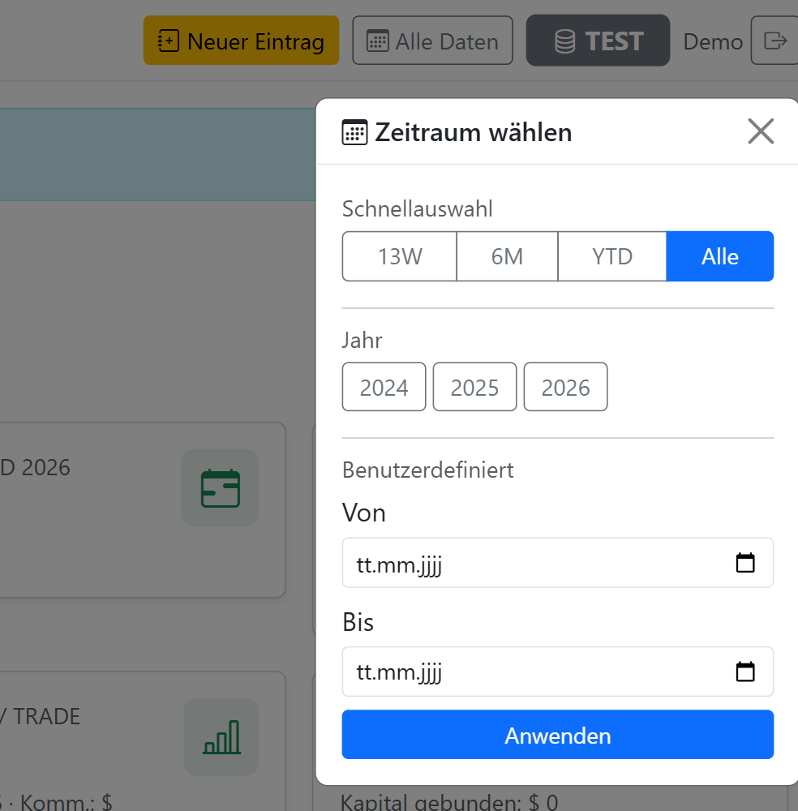

Der **Zeitraum** bietet eine Schnellauswahl (letzte 13 Wochen, 6 Monate, seit Jahresbeginn oder
alle Daten), ganze Jahre oder einen frei gewählten Zeitraum. Die Auswahl bleibt bestehen, bis du
sie änderst.

Das Menü links lässt sich über die Doppelpfeile oben einklappen.

## 2. Dashboard

Die erste Seite nach dem Start: Hier siehst du auf einen Blick, wie es um das Portfolio steht.

- **Kennzahlen-Kacheln** (oberes Bild): P&L für den laufenden Monat, das Jahr und den gewählten
  Zeitraum, Trefferquote (Win Rate), Ø P&L pro Trade, offene Kampagnen, Profit Factor, Max
  Drawdown, Reward/Risk, größter Gewinn und Verlust sowie — wenn Kontoauszüge importiert werden —
  Cash und Kontostand mit Rendite. Welche Kacheln erscheinen, stellst du über das Zahnrad ein.
- **Diagramme:** kumulierter P&L-Verlauf, P&L nach Strategie und nach Option/Aktie, monatlicher
  P&L der letzten 12 Monate und der Kontostand-Verlauf.
- **Optionen, die diese Woche verfallen**, und **aktuelle offene Positionen** ganz unten. Die
  Positionstabelle zeigt alle offenen Positionen (Anzahl im Kopf, bei vielen Einträgen
  scrollbar) und verlinkt auf *Offene Aktien* und *Offene Optionen*.

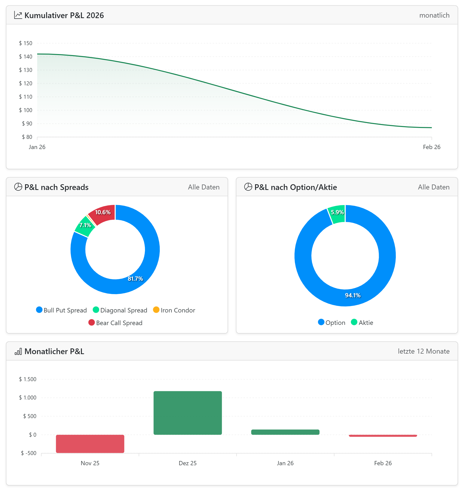

> [!NOTE]
> P&L-Werte stehen überall **brutto** (ohne Kommissionen) mit dem **Netto**-Wert (nach
> Kommissionen) darunter.

## 3. Aktien

Der Aktienbestand, im Menü getrennt nach **Offene Positionen** und **Geschlossene Positionen**.

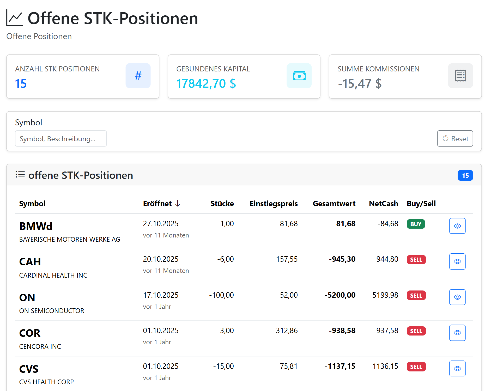

- **Offene Positionen:** Kacheln für Anzahl, gebundenes Kapital und Kommissionen; die Tabelle
  zeigt Symbol, Eröffnungsdatum, Stückzahl, Einstiegspreis, Gesamtwert, Cashflow (NetCash) und
  Kauf/Verkauf. Über das Suchfeld filterst du nach Symbol oder Beschreibung.
- **Geschlossene Positionen:** zusätzlich Haltedauer, Brutto- und Netto-P&L, ROI und Strategie.

**Detailseite** (Augen-Symbol rechts): Preis, Menge, Cashflow, gehaltene Tage, Trade- und
Zeitangaben. Stammt eine Position aus einer **Options-Zuteilung**, zeigt ein eigener Block,
welche Prämie dafür schon kassiert wurde und welcher effektive Einstandspreis sich daraus
ergibt. Bei geschlossenen Positionen steht das Ergebnis in USD und umgerechnet in EUR.

## 4. Optionen

Aufgebaut wie die Aktien-Ansicht, ergänzt um alles, was eine Option ausmacht.

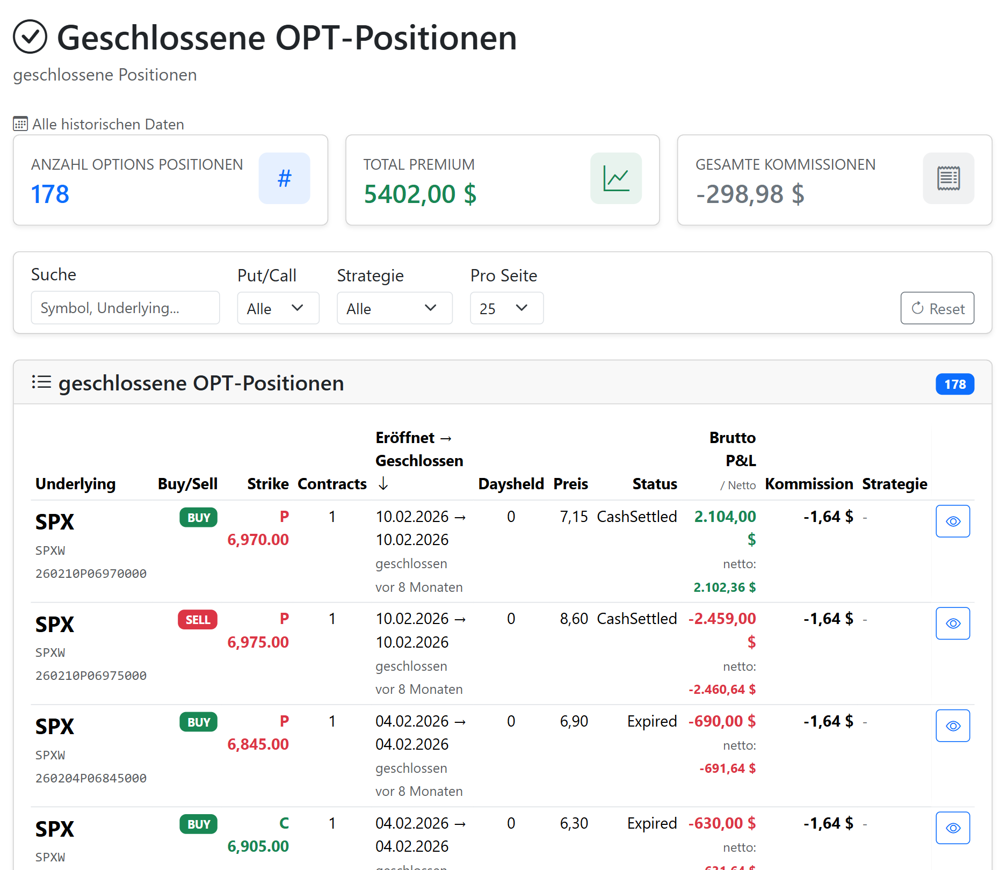

- Strike mit **P**/**C** (Put/Call) und Verfallsdatum; bei offenen Optionen ein deutlicher
  Hinweis, sobald eine Option bereits verfallen ist, die kassierte Prämie und eine Spalte
  **„50%-Ziel“** als Richtwert, ab wann sich ein vorzeitiges Schließen lohnen kann.
- Bei geschlossenen Optionen die **Abschlussart** in der Spalte *Status*: regulär geschlossen,
  *Expired* (verfallen), *Assigned* (zugeteilt) oder *CashSettled* (Barausgleich).
- Filter nach Put/Call und Strategie.

Die **Detailseite** zeigt zusätzlich Multiplikator, Strategie und die Wechselkurse bei Eröffnung
und Schließung.

## 5. Kampagnen

Eine Kampagne bündelt alles, was zusammenhängend zu einem Symbol gehandelt wurde — zum Beispiel
ein Wheel aus verkauften Puts, Aktienzuteilung und Covered Calls. Statt vieler loser
Einzeltrades erzählt sie die ganze Geschichte einer Position (wie Kampagnen entstehen und enden,
beschreibt [Überblick — vom Trade bis zur Auswertung](10-ueberblick.md)).

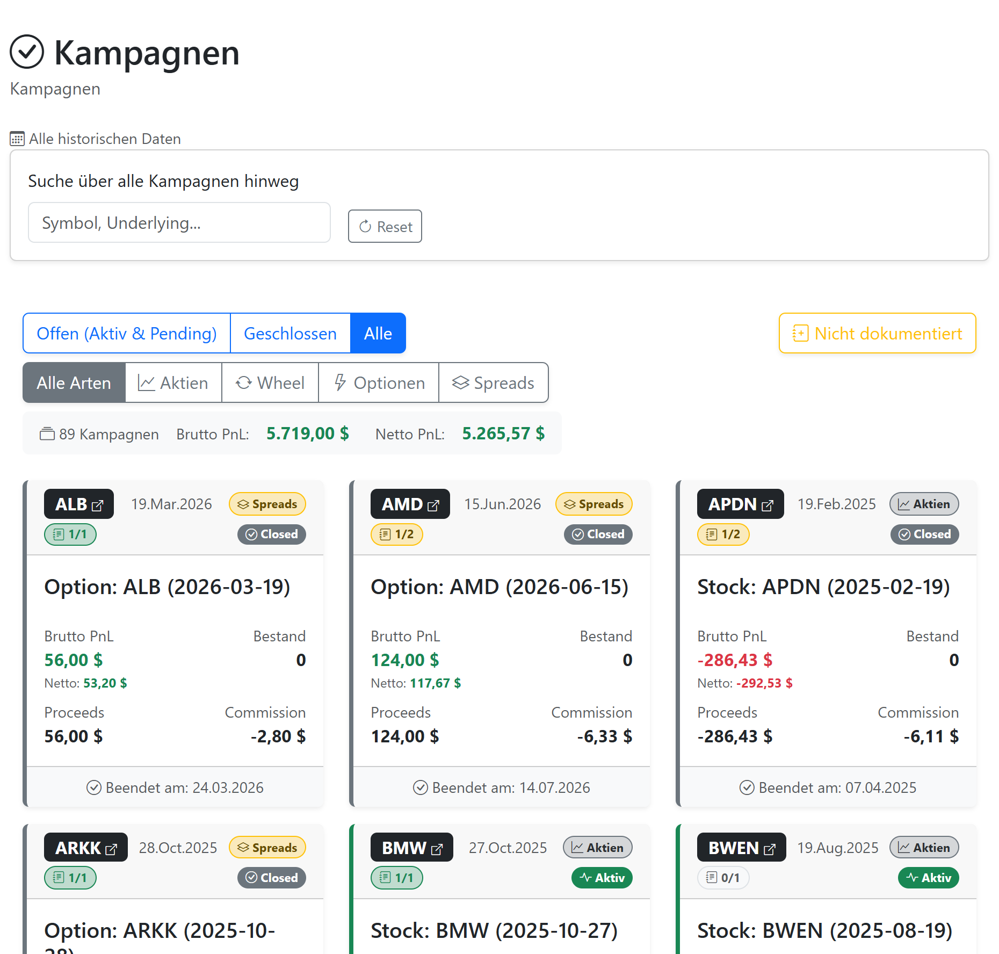

**Liste:** eine Karte je Kampagne mit Symbol, Startdatum, Status (*Aktiv*, *Pending*,
*Geschlossen*), Brutto- und Netto-P&L, Bestand, Erlösen (Proceeds) und Kommission. Das
**Log-Kennzeichen** zeigt, wie viele Eröffnungen dokumentiert sind (z. B. `1/2`, grün = alle). Oben
umschalten zwischen offenen, geschlossenen und allen Kampagnen; **Nicht dokumentiert** zeigt nur
Kampagnen mit mindestens einer Eröffnung ohne Eintrag. Das Suchfeld durchsucht alle Kampagnen
unabhängig von Status und Zeitraum und zeigt jede als eigene Karte. Über alle Kampagnen eines Symbols
hinweg führt der Klick auf das Symbol auf der Karte.
Daneben filtert eine zweite Knopfreihe nach **Art**: *Aktien* (nur Aktien), *Wheel* (Aktien und
Optionen, mit oder ohne Zuteilung), *Optionen* (nur Einzeloptionen) und *Spreads* (mindestens ein
Leg gehört zu einem Spread). Die Art wird aus allen Buchungen der Kampagne bestimmt und steht als
Etikett auf jeder Karte.

**Detailseite** (Klick auf eine Karte):

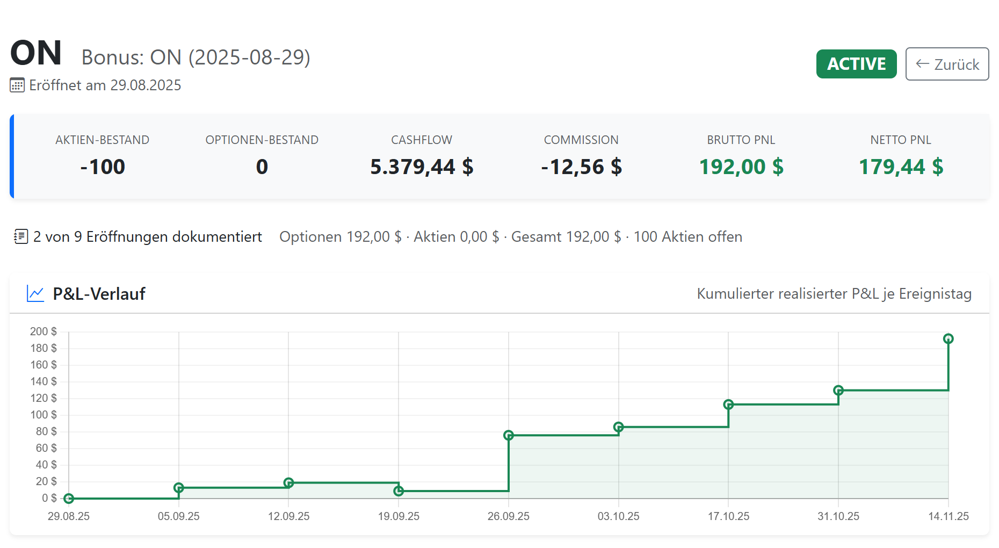

- Kennzahlen: Aktien- und Optionsbestand, Cashflow, Kommission, Brutto- und Netto-P&L.
- **Dokumentation und Summen:** wie viele Eröffnungen dokumentiert sind; bei Aktien in der Kampagne
  zusätzlich P&L von Optionen und Aktien sowie der offene Bestand. Aktien-P&L steht nur in dieser
  Summe, weil eine Aufteilung auf Put und Call willkürlich wäre.
- **P&L-Verlauf** als Stufendiagramm: der aufgelaufene realisierte P&L je Ereignistag.
- **Tages-Übersicht:** je Tag Buchungen, Cashflow, Kommission, P&L und Ereignisse wie Verfall.
- **Transaktions-Historie:** jede Buchung im Klartext (z. B. „Put Prämie: 5x – ON 44,5 P …“),
  mit Mengenänderung, P&L und laufendem Bestand, gruppiert nach Tag mit Tagessumme.
  Zusammengehörige Buchungen (etwa beide Beine einer Rollposition) sind farbig hinterlegt.
  In der Spalte **Log** trägt jede Eröffnung einen Knopf: grün = dokumentiert, gelb umrandet = noch
  nicht (siehe [Abschnitt 7](#7-log--das-entscheidungsjournal)).

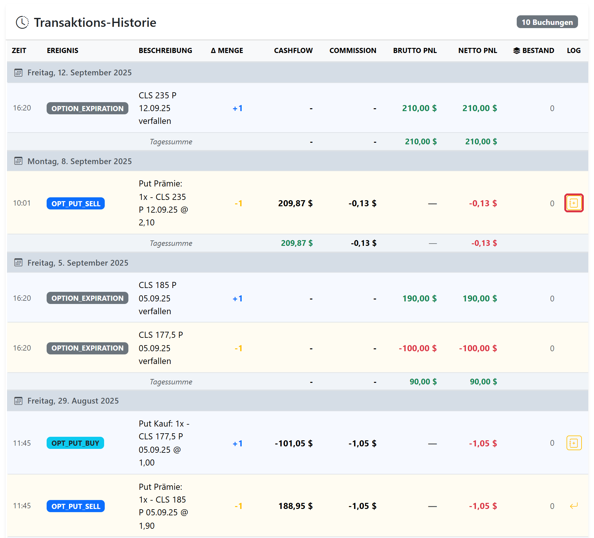

## 6. Spreads

Optionsstrategien aus mehreren Beinen — Vertical Spreads, Iron Condors und Verwandte — werden
hier als **eine** Konstruktion betrachtet, nicht als Handvoll Einzelpositionen. Das Menü bietet
vier Blickwinkel: offene und geschlossene Spreads, Vertical Spreads, Iron Condors.

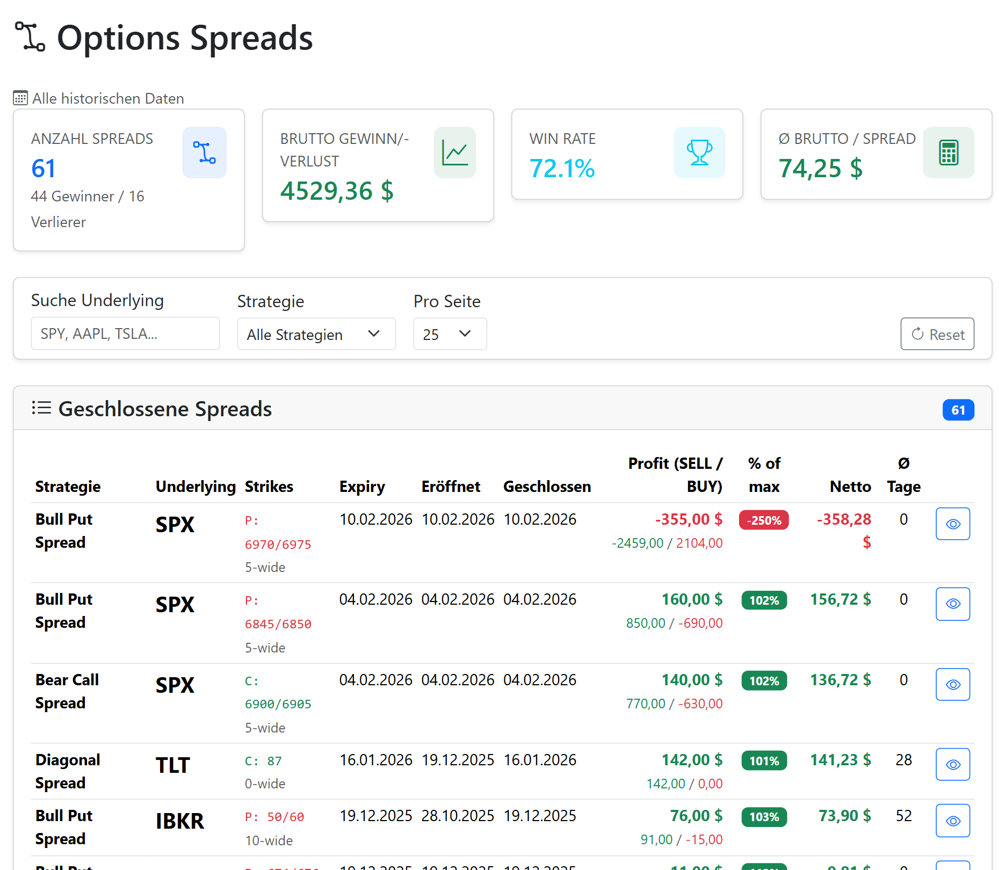

- **Kacheln:** Anzahl (mit Gewinnern/Verlierern), Brutto-Ergebnis, Trefferquote, Ø je Spread.
- **Tabelle:** Strategie, Underlying, Strikes mit Breite, Verfall, Eröffnung/Schließung, Gewinn
  (darunter Verkaufs- und Kaufseite einzeln), **„% of max“** — wie viel vom maximal möglichen
  Gewinn erreicht wurde —, Netto und Ø Haltedauer.

**Detailseite:** Kennzahlen (Ergebnis, erhaltene/gezahlte Prämie, Haltedauer, Kommission), alle
Beine in einer Tabelle, ein Performance-Block (ROI, Gewinn pro Tag) und die Verknüpfung zum
Psychologie-Eintrag — fehlt er noch, lässt er sich hier direkt anlegen. Bei einem **Iron Condor**
zeigt eine Strukturgrafik Put- und Call-Spread nebeneinander, je mit Strikes, Breite und — bei
geschlossenen — Ergebnis.

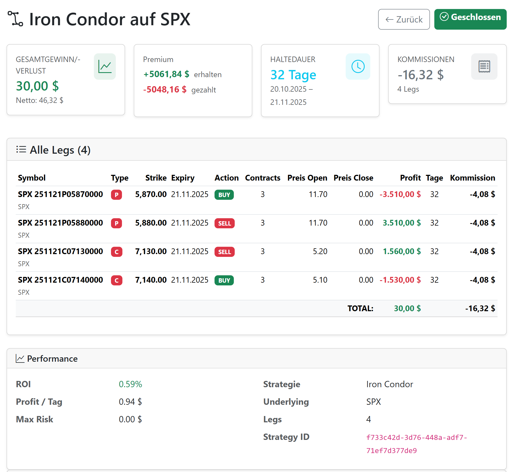

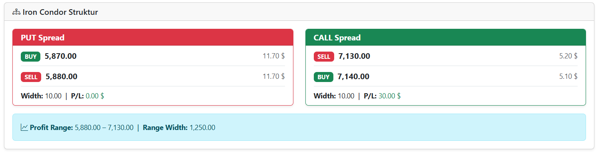

## 7. Log — das Entscheidungsjournal

Der Kern eines Trading-Journals: Nicht nur das Ergebnis zählt, sondern der Gedanke dahinter.
Dokumentiert wird direkt dort, wo der Trade steht: in der **Buchungszeile der Eröffnung**.

**Knopf in der Zeile:** Eine Eröffnung sind alle zum selben Zeitpunkt eröffneten Legs (Put, Spread,
Iron Condor) oder ein Aktienkauf. Jede hat in der Transaktions-Historie einer Kampagne genau einen
Knopf, ebenso in der Symbol-Ansicht und unter *Aktivität*; weitere Legs zeigen nur einen kleinen Pfeil.
Aktien aus einer Zuteilung haben keinen Knopf, weil sie keine eigene Entscheidung sind. Ein Folgetrade
im selben Underlying hat seinen eigenen Knopf, ein Wheel erscheint als Folge seiner Puts und Calls.

**Das Fenster** hat die Reiter *Trade* und *Psychologie* (siehe Abschnitt 8) und einen gemeinsamen
Knopf zum Speichern. Es lässt sich an der Kopfzeile verschieben und an der rechten unteren Ecke
vergrößern:

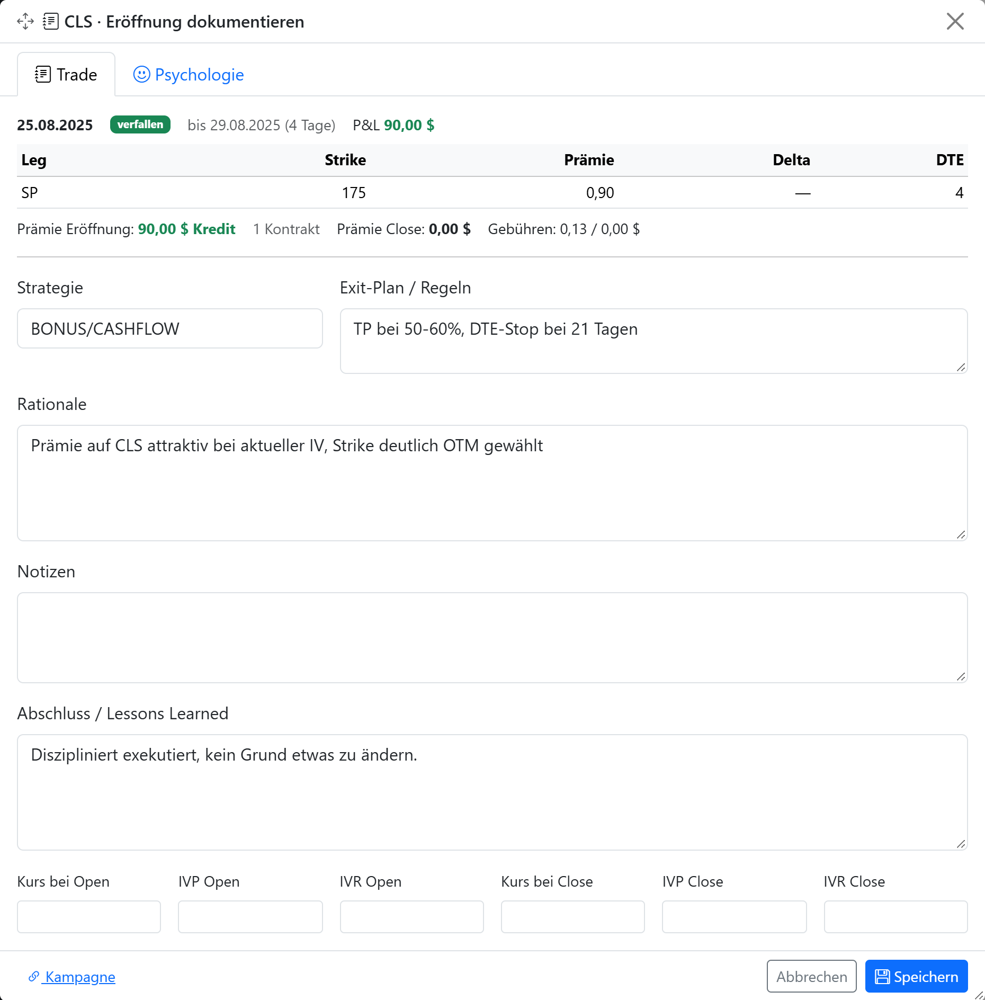

- **Oben die Zahlen aus den Buchungen,** nur zur Anzeige: Legs mit Strike, Prämie, Delta und DTE,
  Prämie der Eröffnung und beim Schließen in Dollar, Gebühren, maximales Risiko beim Vertical,
  Ausgang und P&L (**brutto**, wie in Kampagnen, Spreads und Statistik). Du trägst sie nicht ein,
  sie können also nicht von den Buchungen abweichen. Wurde ein Spread zugeteilt und sind die Aktien
  im selben Moment wieder glatt, zählt deren P&L mit; bleiben die Aktien liegen, steht ihr P&L nur
  in der Summe der Kampagne.
- **Dein Eintrag:** Strategie, Exit-Plan bzw. Regeln, Begründung (*Rationale*) und Notizen. Sobald
  die Eröffnung geschlossen ist, kommt **Abschluss / Lessons Learned** dazu.
- **Kurs und IV:** Ist im Weaver der optionale Schritt `enrich` eingerichtet (siehe
  [Alltag mit dem TradingJournal](70-alltag.md), Abschnitt 1, „Delta und IV-Rang automatisch“),
  stehen Kurs des Basiswerts und IVP/IVR bei Eröffnung und Schließung als berechnete Werte im
  Feld. Was du selbst einträgst, gilt; ohne `enrich` bleiben die Felder für deine Eingabe.

**Alle Einträge lesen:** Unter **Analyse → Trade-Kommentare** stehen alle Einträge untereinander, mit
Filter nach Underlying und Status; Status und P&L kommen aus den Buchungen. Dort lassen sich Einträge
auch löschen.

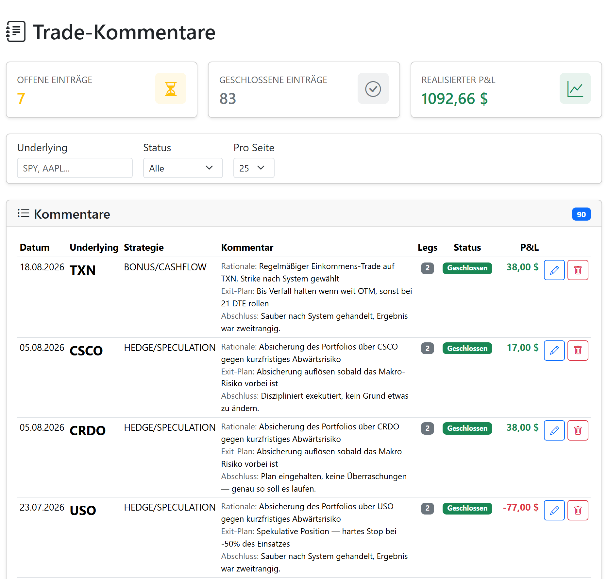

**Einträge ohne Kampagne:** Aus früheren Versionen können solche Einträge vorhanden sein. Sie lassen
sich unter *Trade-Kommentare* weiter bearbeiten und mit einer passenden Kampagne verknüpfen; sie
gehören dann zur noch nicht kommentierten Eröffnung, die ihrem Datum am nächsten liegt. Neue Einträge
entstehen nur noch über den Knopf in der Zeile.

Psychologie-Einträge aus früheren Versionen ordnet das Update ihrer Eröffnung zu und übernimmt die
Lektion in *Abschluss / Lessons Learned*. Was sich nicht zuordnen lässt, steht unter
*Trade-Kommentare* in einem eigenen Kasten und bleibt dort bearbeitbar.

## 8. Psychologie

Das Modul trennt bewusst das **Ergebnis** eines Trades von der Frage, **wie** er zustande kam.
Ein Gewinn aus einer disziplinierten Entscheidung und einer aus einem Impuls sehen im P&L gleich
aus — hier wird sichtbar, welcher es war.

**Erfasst wird im Log-Fenster,** im Reiter **Psychologie** derselben Eröffnung (siehe
[Abschnitt 7](#7-log--das-entscheidungsjournal)): Stimmung vor und nach dem Trade (Skala 1–5),
Motivation (System, FOMO, Revenge, Langeweile, Impuls), Marktlage, Einhaltung der Regeln und
Versuchungen. Nichts davon ist Pflicht: Ohne Angaben entsteht kein Psychologie-Eintrag, und die
Regeln zählen nur, wenn du mindestens eine angekreuzt hast. Ein Punkt am Knopf zeigt, dass die
Psychologie ausgefüllt ist. Die Lektion steht im Reiter *Trade* unter **Abschluss / Lessons
Learned**. Unter *Analyse → Trade-Kommentare* siehst du Motivation, Stimmung und Regeln beim
jeweiligen Eintrag; das Löschen entfernt beides.

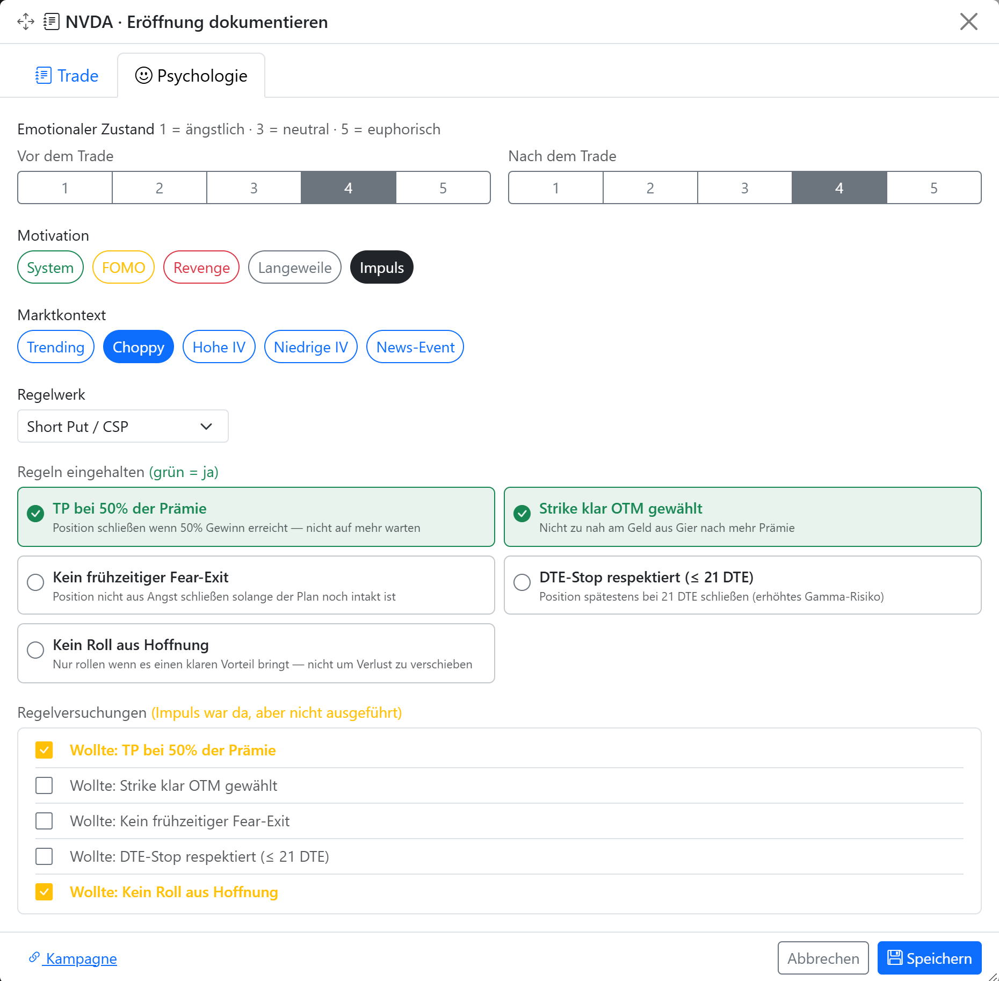

Im Menü stehen zwei Punkte:

- **Regelwerke:** die Maßstäbe — Regelwerke (Name, Strategie, aktiv/inaktiv) mit Einzelregeln
  und ihrem Fehlertyp (Gier, Angst, Hoffnung, Impuls, Disziplin). Am besten zuerst einrichten.
- **Auswertung:** vier Diagramme machen Muster sichtbar — *Cost of Emotion* (Ø P&L je
  Motivation), *Emotional Sweet Spot* (Ø P&L je Stimmung), *Compliance-Performance* (Ø P&L je
  Grad der Regel-Einhaltung) und *Regelversuchungen* (wie oft welche Regel in Versuchung führte).
  Das P&L kommt aus den Buchungen der Eröffnung, noch offene zählen nicht mit. Oben steht, zu wie
  vielen dokumentierten Eröffnungen die Psychologie ausgefüllt ist.

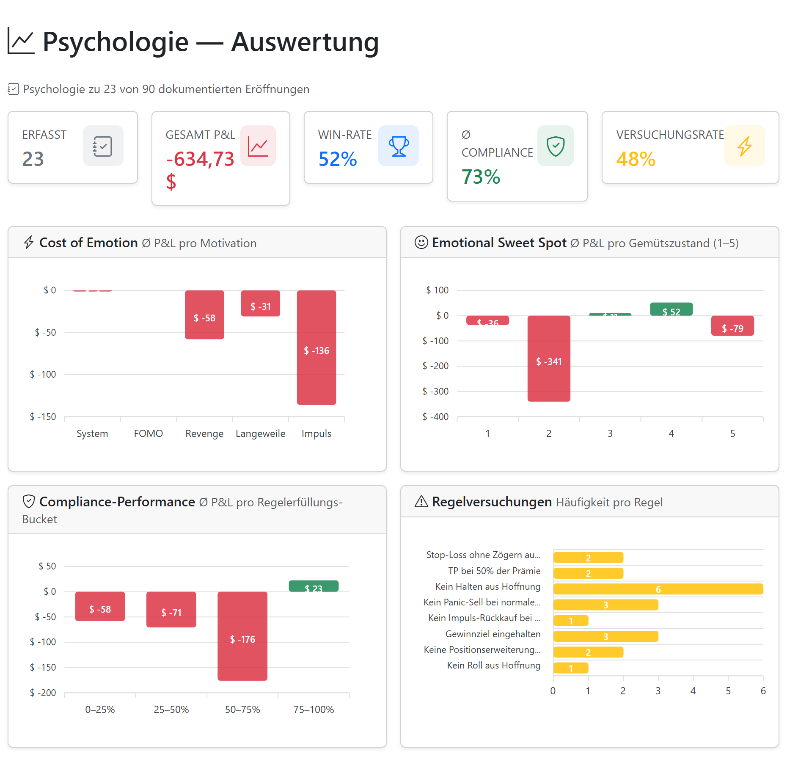

## 9. Analyse

Fünf Ansichten zum Tiefergraben:

| Ansicht | Was sie zeigt |
|---|---|
| **Symbole** | alle je gehandelten Symbole mit Anzahl Kampagnen, letzter Aktivität, Brutto-/Netto-P&L und Trefferquote; Detailseite mit P&L-Verlauf und allen Kampagnen des Symbols |
| **Stats** | Ergebnisse nach Tagen, Wochen, Monaten oder Jahren (siehe unten) |
| **Aktivität** | wochenweise blätterbare Buchungshistorie über alle Symbole — wie die Transaktions-Historie einer Kampagne, nur für alles |
| **FX-Trades** | reine Währungstausche (z. B. USD ↔ EUR); Teilausführungen einer Order werden zu einer Summenzeile zusammengefasst und lassen sich aufklappen |
| **Raw Data** | die Trades genau so, wie sie aus dem IBKR-Bericht kamen, mit Verarbeitungsstatus — um eine Zahl bis zu ihrem Ursprung zurückzuverfolgen |

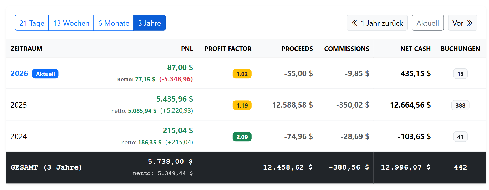

**Stats** schaltet oben zwischen 21 Tagen, 13 Wochen, 6 Monaten und 3 Jahren um und blättert
rechts zeitlich vor und zurück; unten steht jeweils die Summe.

- **Wochen, Monate, Jahre** (Bild): P&L (brutto, darunter netto und die Veränderung), Profit
  Factor, Erlöse (Proceeds), Kommissionen, Cashflow (Net Cash) und Anzahl Buchungen.
- **Tage:** P&L mit Veränderung zum Vortag, Buchungen, Gewinner/Verlierer, Ø Trade, Kommission
  und der im Monat aufgelaufene P&L.

> [!TIP]
> Stats zählt **Buchungen**, nicht Trades: Ein geschlossener Trade besteht aus Eröffnung und
> Schließung, also zwei Buchungen.
