# Rundgang durch die App

Dieses Kapitel führt einmal durch alle Bereiche des TradingJournal: wofür sie gedacht sind und
welche Kennzahlen, Tabellen und Diagramme dich dort erwarten. Die Reihenfolge folgt dem Menü
links. Kurze Erklärungen zu jeder Seite gibt es auch direkt in der App unter **Hilfe**.

> [!NOTE]
> Die Bilder stammen aus der Demo-Version mit erfundenen Daten. Bei dir sehen Zahlen, Symbole
> und Umfang natürlich anders aus.

---

## 1. Kopfzeile — was auf jeder Seite gilt

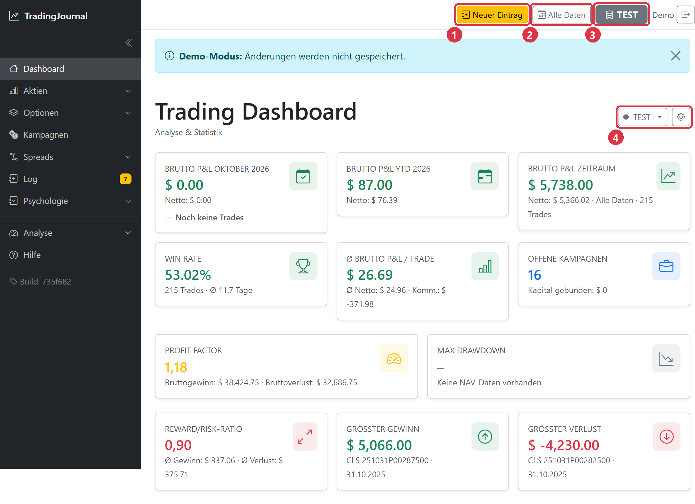

| Nr. | Element | Wofür |
|---|---|---|
| 1 | **Neuer Eintrag** (gelb) | öffnet sofort ein neues Formular im [Log](#7-log--das-entscheidungsjournal), um eine Trade-Idee festzuhalten, solange sie frisch ist |
| 2 | **Zeitraum** (hier „Alle Daten“) | grenzt fast jede Liste, Kennzahl und jedes Diagramm auf ein Zeitfenster ein; die Beschriftung zeigt die aktuelle Auswahl |
| 3 | **Environment-Badge** | zeigt, in welchem Datenbereich du gerade bist (`MONEY`, `PAPER`, `TEST`, `AUTOM_MONEY`, `AUTOM_PAPER`) |
| 4 | **Environment-Umschalter** und **Zahnrad** (auf dem Dashboard) | wechselt den Datenbereich bzw. wählt aus, welche Kacheln das Dashboard zeigt — siehe [Erster Start — UI-Erstkonfiguration](60-erster-start.md) |

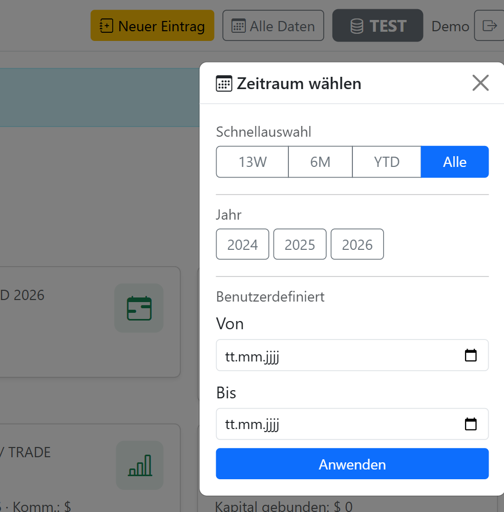

Der **Zeitraum** bietet eine Schnellauswahl (letzte 13 Wochen, 6 Monate, seit Jahresbeginn oder
alle Daten), ganze Jahre oder einen frei gewählten Zeitraum. Die Auswahl bleibt bestehen, bis du
sie änderst.

Das Menü links lässt sich über die Doppelpfeile oben einklappen; die Zahl neben **Log** zählt
Kampagnen, die noch nicht im Log dokumentiert sind (siehe Abschnitt 7).

## 2. Dashboard

Die erste Seite nach dem Start: Hier siehst du auf einen Blick, wie es um das Portfolio steht.

- **Kennzahlen-Kacheln** (oberes Bild): P&L für den laufenden Monat, das Jahr und den gewählten
  Zeitraum, Trefferquote (Win Rate), Ø P&L pro Trade, offene Kampagnen, Profit Factor, Max
  Drawdown, Reward/Risk, größter Gewinn und Verlust sowie — wenn Kontoauszüge importiert werden —
  Cash und Kontostand mit Rendite. Welche Kacheln erscheinen, stellst du über das Zahnrad ein.
- **Diagramme:** kumulierter P&L-Verlauf, P&L nach Strategie und nach Option/Aktie, monatlicher
  P&L der letzten 12 Monate und der Kontostand-Verlauf.
- **Optionen, die diese Woche verfallen**, und **aktuelle offene Positionen** ganz unten.

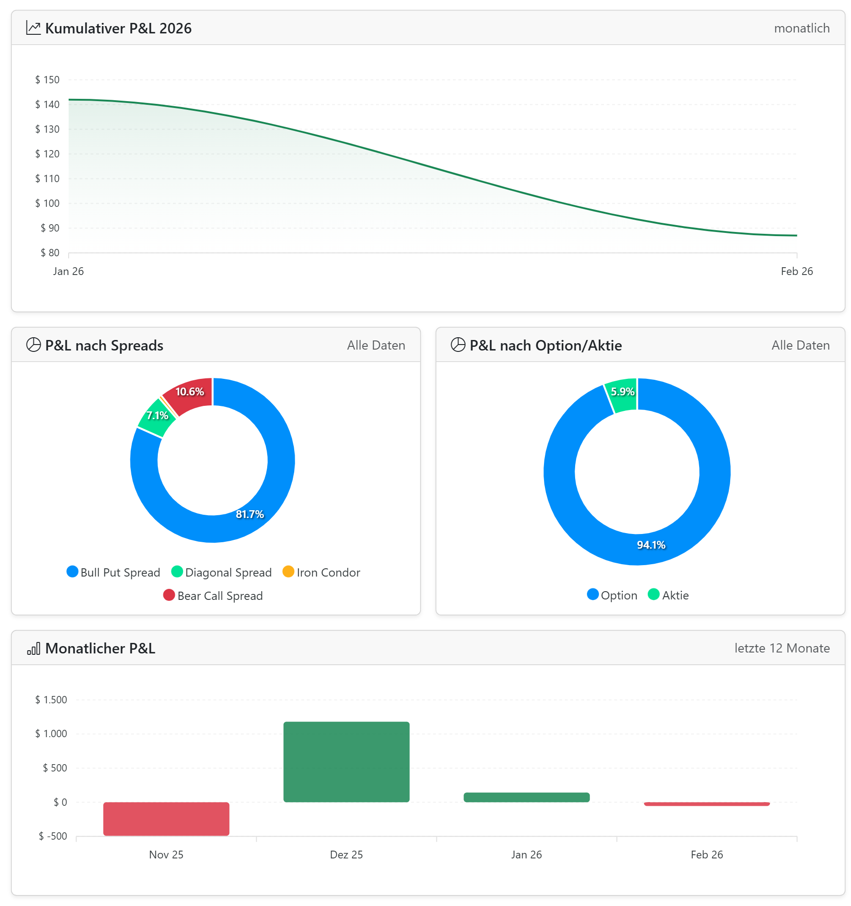

> [!NOTE]
> P&L-Werte stehen überall **brutto** (ohne Kommissionen) mit dem **Netto**-Wert (nach
> Kommissionen) darunter.

## 3. Aktien

Der Aktienbestand, im Menü getrennt nach **Offene Positionen** und **Geschlossene Positionen**.

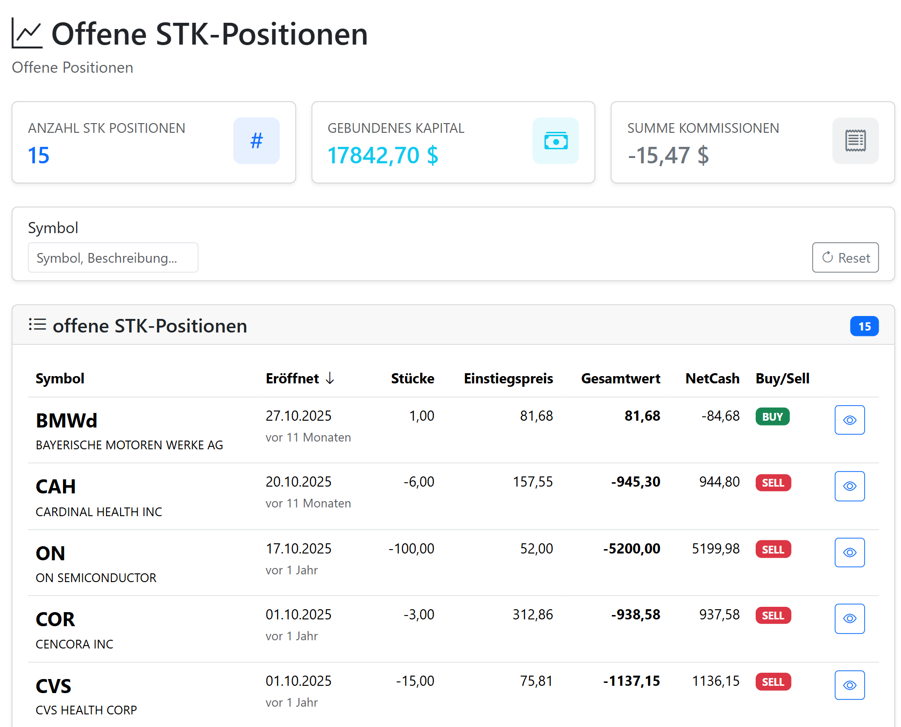

- **Offene Positionen:** Kacheln für Anzahl, gebundenes Kapital und Kommissionen; die Tabelle
  zeigt Symbol, Eröffnungsdatum, Stückzahl, Einstiegspreis, Gesamtwert, Cashflow (NetCash) und
  Kauf/Verkauf. Über das Suchfeld filterst du nach Symbol oder Beschreibung.
- **Geschlossene Positionen:** zusätzlich Haltedauer, Brutto- und Netto-P&L, ROI und Strategie.

**Detailseite** (Augen-Symbol rechts): Preis, Menge, Cashflow, gehaltene Tage, Trade- und
Zeitangaben. Stammt eine Position aus einer **Options-Zuteilung**, zeigt ein eigener Block,
welche Prämie dafür schon kassiert wurde und welcher effektive Einstandspreis sich daraus
ergibt. Bei geschlossenen Positionen steht das Ergebnis in USD und umgerechnet in EUR.

## 4. Optionen

Aufgebaut wie die Aktien-Ansicht, ergänzt um alles, was eine Option ausmacht.

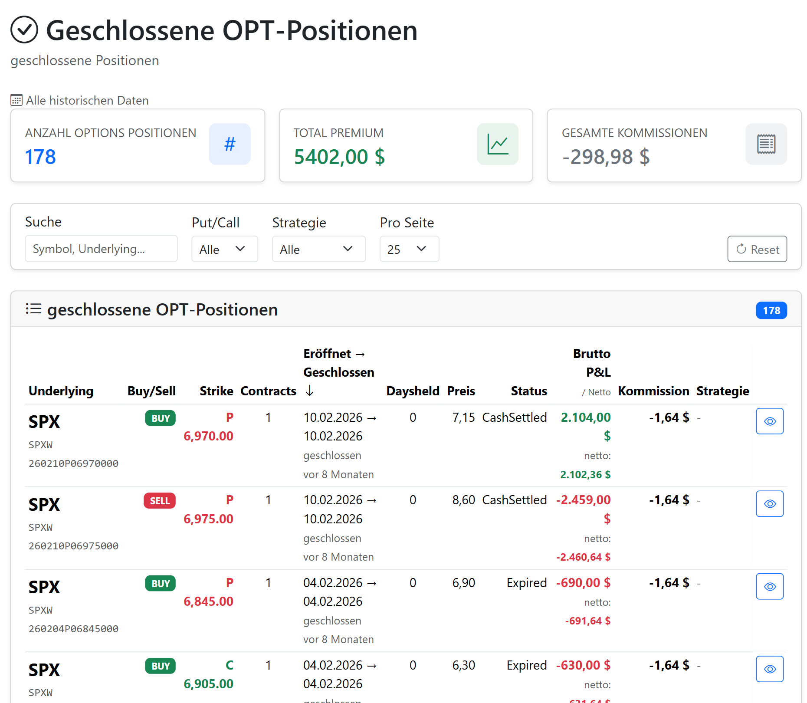

- Strike mit **P**/**C** (Put/Call) und Verfallsdatum; bei offenen Optionen ein deutlicher
  Hinweis, sobald eine Option bereits verfallen ist, die kassierte Prämie und eine Spalte
  **„50%-Ziel“** als Richtwert, ab wann sich ein vorzeitiges Schließen lohnen kann.
- Bei geschlossenen Optionen die **Abschlussart** in der Spalte *Status*: regulär geschlossen,
  *Expired* (verfallen), *Assigned* (zugeteilt) oder *CashSettled* (Barausgleich).
- Filter nach Put/Call und Strategie.

Die **Detailseite** zeigt zusätzlich Multiplikator, Strategie und die Wechselkurse bei Eröffnung
und Schließung.

## 5. Kampagnen

Eine Kampagne bündelt alles, was zusammenhängend zu einem Symbol gehandelt wurde — zum Beispiel
ein Wheel aus verkauften Puts, Aktienzuteilung und Covered Calls. Statt vieler loser
Einzeltrades erzählt sie die ganze Geschichte einer Position (wie Kampagnen entstehen und enden,
beschreibt [Überblick — vom Trade bis zur Auswertung](10-ueberblick.md)).

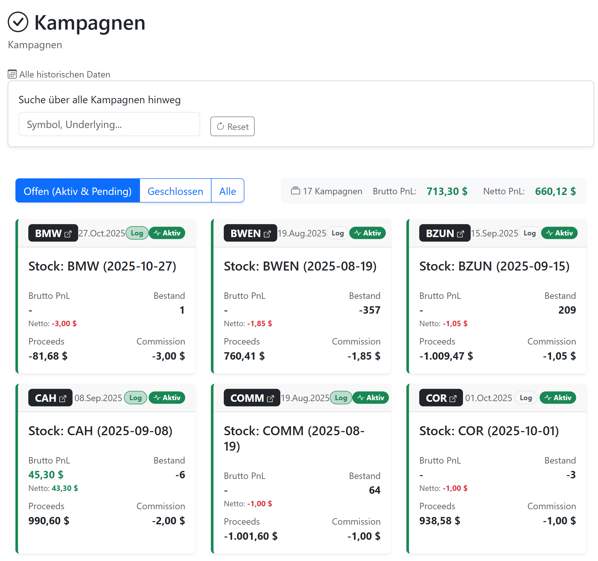

**Liste:** eine Karte je Kampagne mit Symbol, Startdatum, Status (*Aktiv*, *Pending*,
*Geschlossen*), Brutto- und Netto-P&L, Bestand, Erlösen (Proceeds) und Kommission. Das
**Log-Badge** zeigt, ob die Kampagne schon im Log dokumentiert ist (grün hinterlegt = ja). Oben
umschalten zwischen offenen, geschlossenen und allen Kampagnen; das Suchfeld durchsucht alle.

**Detailseite** (Klick auf eine Karte):

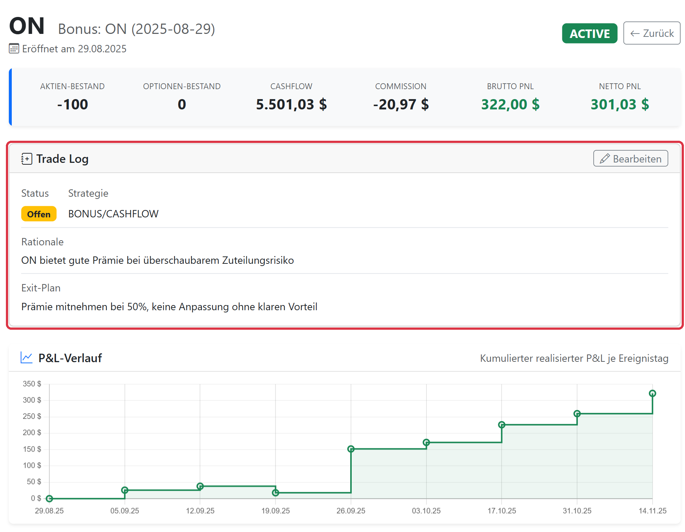

- Kennzahlen: Aktien- und Optionsbestand, Cashflow, Kommission, Brutto- und Netto-P&L.
- **Trade Log** (markiert): der verknüpfte Log-Eintrag mit Strategie, Begründung (Rationale)
  und Exit-Plan — so stehen Plan und Ergebnis nebeneinander.
- **P&L-Verlauf** als Stufendiagramm: der aufgelaufene realisierte P&L je Ereignistag.
- **Tages-Übersicht:** je Tag Buchungen, Cashflow, Kommission, P&L und Ereignisse wie Verfall.
- **Transaktions-Historie:** jede Buchung im Klartext (z. B. „Put Prämie: 5x – ON 44,5 P …“),
  mit Mengenänderung, P&L und laufendem Bestand, gruppiert nach Tag mit Tagessumme.
  Zusammengehörige Buchungen (etwa beide Beine einer Rollposition) sind farbig hinterlegt.

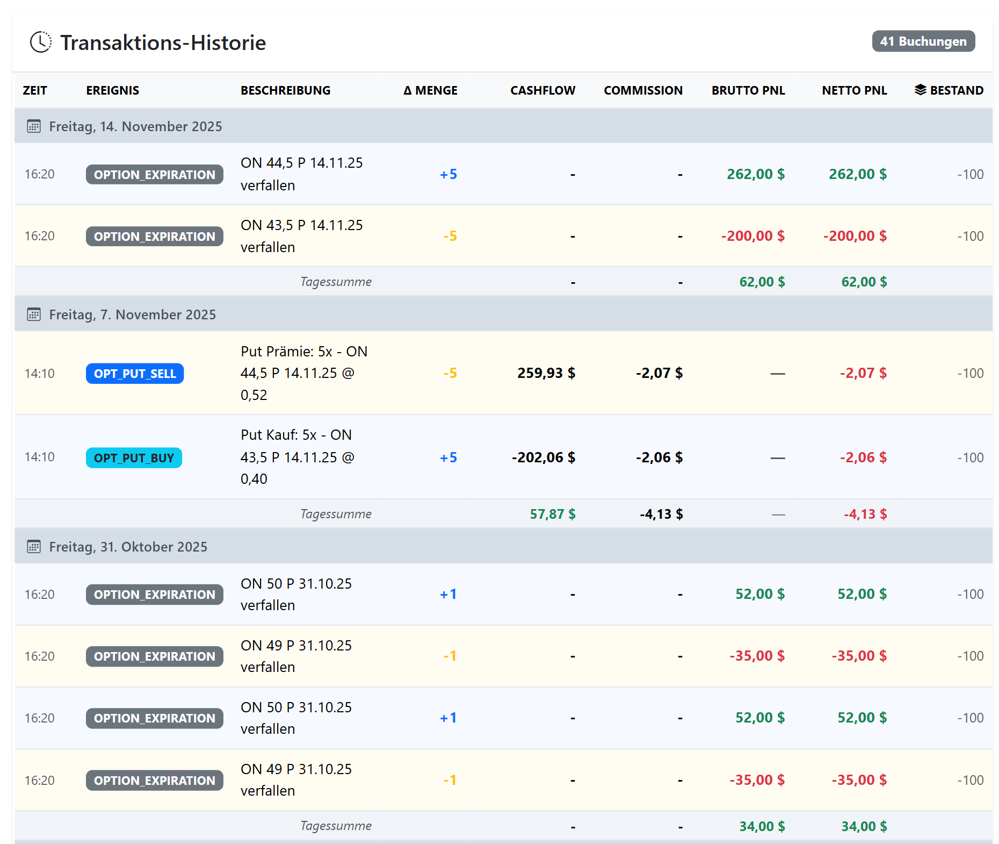

## 6. Spreads

Optionsstrategien aus mehreren Beinen — Vertical Spreads, Iron Condors und Verwandte — werden
hier als **eine** Konstruktion betrachtet, nicht als Handvoll Einzelpositionen. Das Menü bietet
vier Blickwinkel: offene und geschlossene Spreads, Vertical Spreads, Iron Condors.

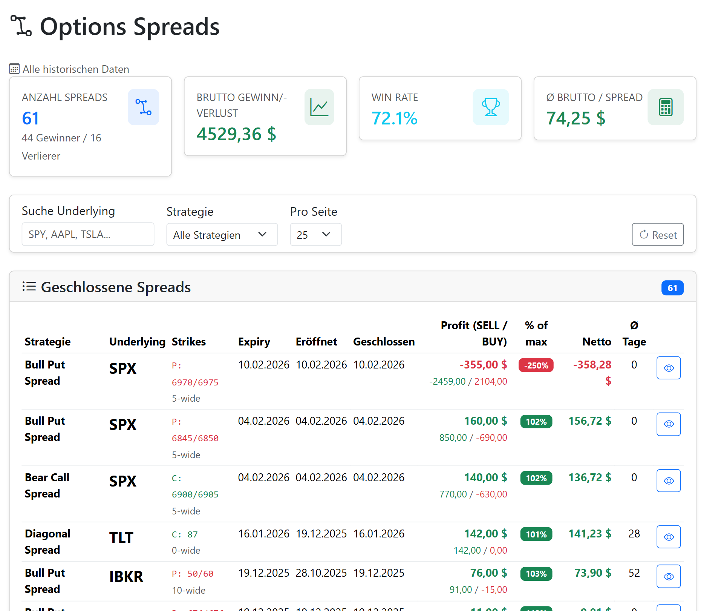

- **Kacheln:** Anzahl (mit Gewinnern/Verlierern), Brutto-Ergebnis, Trefferquote, Ø je Spread.
- **Tabelle:** Strategie, Underlying, Strikes mit Breite, Verfall, Eröffnung/Schließung, Gewinn
  (darunter Verkaufs- und Kaufseite einzeln), **„% of max“** — wie viel vom maximal möglichen
  Gewinn erreicht wurde —, Netto und Ø Haltedauer.

**Detailseite:** Kennzahlen (Ergebnis, erhaltene/gezahlte Prämie, Haltedauer, Kommission), alle
Beine in einer Tabelle, ein Performance-Block (ROI, Gewinn pro Tag) und die Verknüpfung zum
Psychologie-Eintrag — fehlt er noch, lässt er sich hier direkt anlegen.

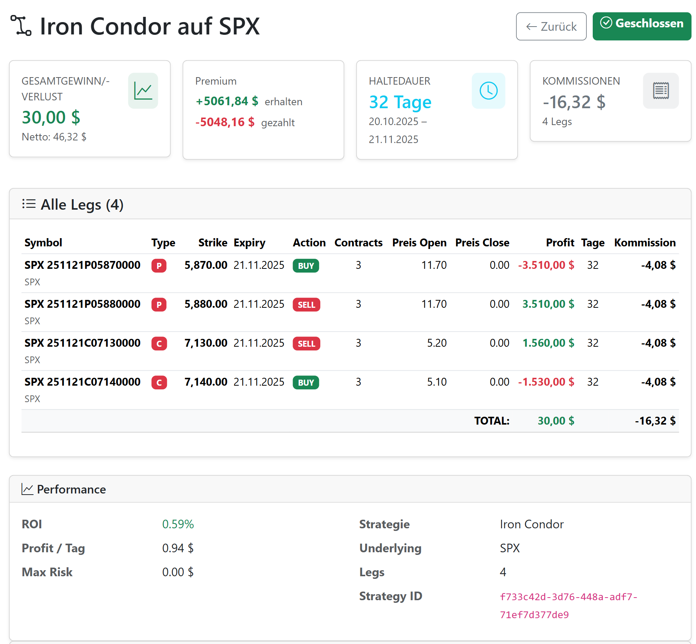

## 7. Log — das Entscheidungsjournal

Der Kern eines Trading-Journals: Nicht nur das Ergebnis zählt, sondern der Gedanke dahinter.
Hier hältst du fest, **warum** ein Trade eingegangen wurde — mit welchem Plan, welcher Erwartung
und welchem Ausstiegsszenario.

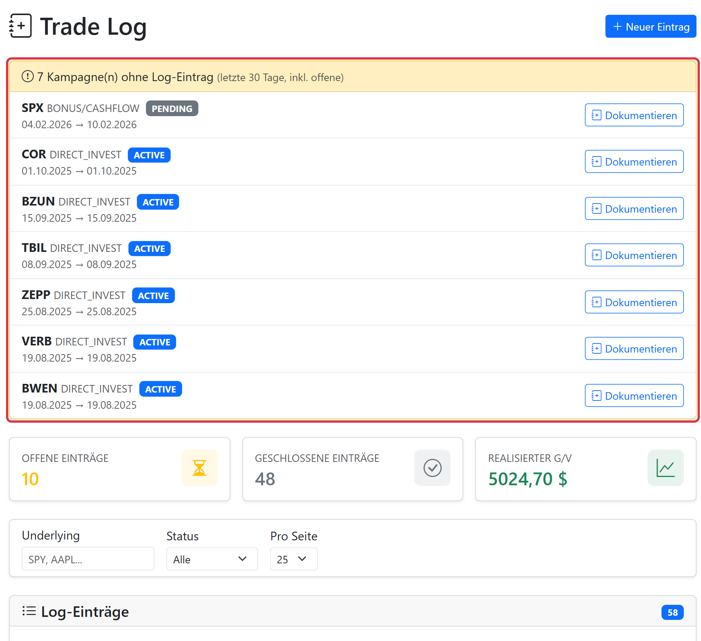

- **Hinweisbox** (markiert): Kampagnen der letzten 30 Tage ohne Log-Eintrag. **Dokumentieren**
  öffnet ein Formular, das mit den Daten der Kampagne vorausgefüllt ist und sie automatisch
  verknüpft. Die Zahl neben *Log* im Menü zählt genau diese Kampagnen.
- **Kacheln** für offene und geschlossene Einträge sowie den realisierten Gewinn, darunter die
  Tabelle aller Einträge mit Filter nach Underlying und Status.

**Neuer Eintrag:**

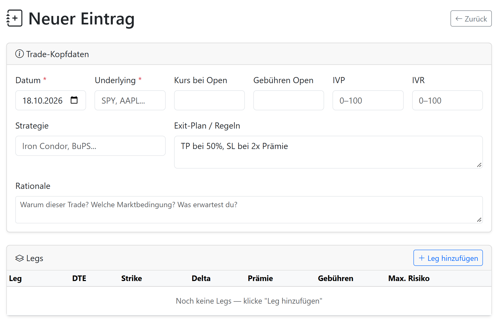

- **Kopfdaten:** Datum, Underlying, Kurs und Gebühren bei Eröffnung, IV-Perzentil (IVP) und
  IV-Rang (IVR), Strategie, Exit-Plan bzw. Regeln und die Begründung (*Rationale*) in eigenen
  Worten.
- **Legs:** die Beine des Trades mit Restlaufzeit (DTE), Strike, Delta, Prämie, Gebühren und
  maximalem Risiko.
- **Trade schließen:** ergänzt Kurs, Prämie, realisiertes Ergebnis und Notizen — so schließt sich
  der Kreis vom Plan zum Ausgang.

## 8. Psychologie

Das Modul trennt bewusst das **Ergebnis** eines Trades von der Frage, **wie** er zustande kam.
Ein Gewinn aus einer disziplinierten Entscheidung und einer aus einem Impuls sehen im P&L gleich
aus — hier wird sichtbar, welcher es war. Das Menü hat vier Punkte:

- **Regelwerke:** die Maßstäbe — Regelwerke (Name, Strategie, aktiv/inaktiv) mit Einzelregeln
  und ihrem Fehlertyp (Gier, Angst, Hoffnung, Impuls, Disziplin). Am besten zuerst einrichten.
- **Neuer Eintrag:** Symbol, Datum, P&L, Stimmung vor und nach dem Trade (Skala 1–5), Motivation
  (System, FOMO, Revenge, Langeweile, Impuls), Marktlage, Einhaltung jeder Regel, Versuchungen
  und die Lektion, die du mitnimmst.
- **Einträge:** Kacheln (Anzahl, P&L, Trefferquote, Anteil mit Versuchung) und je Eintrag eine
  Zeile mit Motivation, Anzahl der Versuchungen (⚡), der Regel-Einhaltung als Punkte (grün =
  eingehalten, rot = gebrochen), P&L und Lektion.

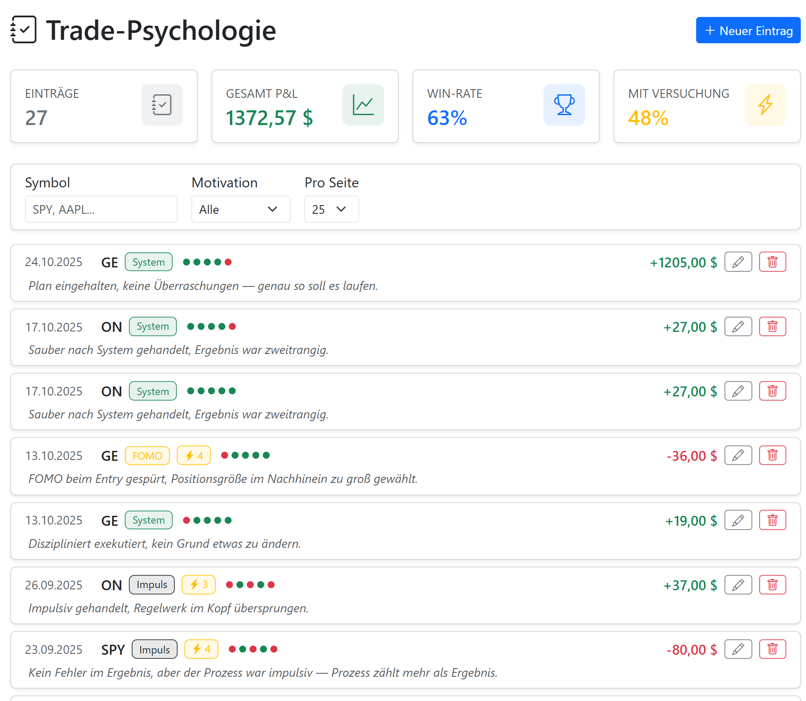

- **Auswertung:** vier Diagramme machen Muster sichtbar — *Cost of Emotion* (Ø P&L je
  Motivation), *Emotional Sweet Spot* (Ø P&L je Stimmung), *Compliance-Performance* (Ø P&L je
  Grad der Regel-Einhaltung) und *Regelversuchungen* (wie oft welche Regel in Versuchung führte).

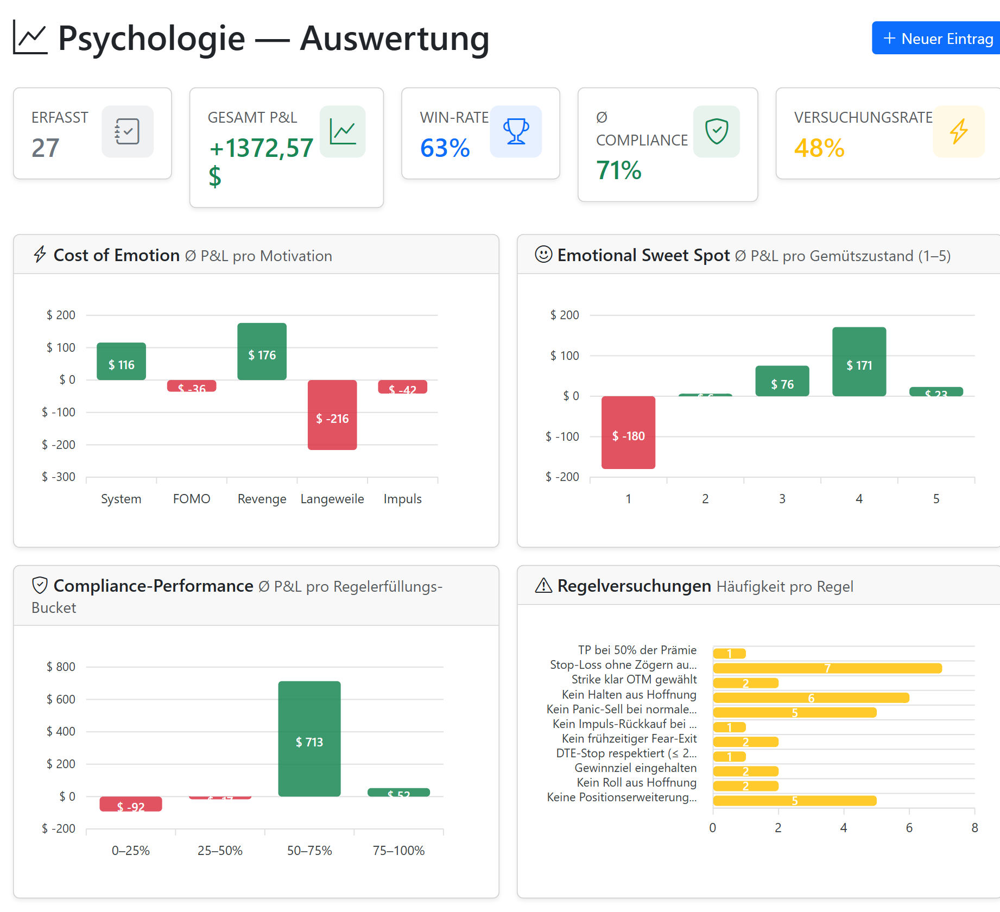

## 9. Analyse

Fünf Ansichten zum Tiefergraben:

| Ansicht | Was sie zeigt |
|---|---|
| **Symbole** | alle je gehandelten Symbole mit Anzahl Kampagnen, letzter Aktivität, Brutto-/Netto-P&L und Trefferquote; Detailseite mit P&L-Verlauf und allen Kampagnen des Symbols |
| **Stats** | Ergebnisse nach Tagen, Wochen, Monaten oder Jahren (siehe unten) |
| **Aktivität** | wochenweise blätterbare Buchungshistorie über alle Symbole — wie die Transaktions-Historie einer Kampagne, nur für alles |
| **FX-Trades** | reine Währungstausche (z. B. USD ↔ EUR); Teilausführungen einer Order werden zu einer Summenzeile zusammengefasst und lassen sich aufklappen |
| **Raw Data** | die Trades genau so, wie sie aus dem IBKR-Bericht kamen, mit Verarbeitungsstatus — um eine Zahl bis zu ihrem Ursprung zurückzuverfolgen |

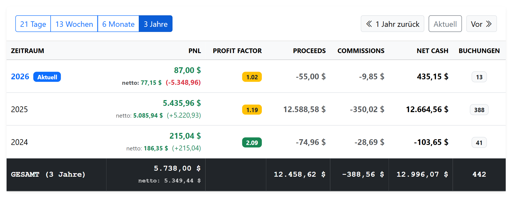

**Stats** schaltet oben zwischen 21 Tagen, 13 Wochen, 6 Monaten und 3 Jahren um und blättert
rechts zeitlich vor und zurück; unten steht jeweils die Summe.

- **Wochen, Monate, Jahre** (Bild): P&L (brutto, darunter netto und die Veränderung), Profit
  Factor, Erlöse (Proceeds), Kommissionen, Cashflow (Net Cash) und Anzahl Buchungen.
- **Tage:** P&L mit Veränderung zum Vortag, Buchungen, Gewinner/Verlierer, Ø Trade, Kommission
  und der im Monat aufgelaufene P&L.

> [!TIP]
> Stats zählt **Buchungen**, nicht Trades: Ein geschlossener Trade besteht aus Eröffnung und
> Schließung, also zwei Buchungen.
