# IBKR einrichten — Flex Queries und Kontoauszug

Damit das Journal Daten bekommt, muss im IBKR-Kundenportal einmalig festgelegt werden, **welche
Berichte** IBKR erstellt und **wie** sie zugestellt werden. Dieses Kapitel zeigt die Einrichtung
Schritt für Schritt — mit den Einstellungen, die im täglichen Betrieb funktionieren.

Insgesamt werden bis zu drei Berichte eingerichtet:

| Bericht | Zweck im Journal | Zustellung | Pflicht? |
|---|---|---|---|
| **Flex Query für E-Mail** | alle Trades, Verfall/Zuteilung von Optionen, Splits | täglich per E-Mail | ja |
| **Flex Query für Web-API** | dieselben Daten über einen zweiten, unabhängigen Kanal | Abruf mit Prüfcode | optional |
| **Kontoauszug (CSV)** | Kontostand, Cash, Tagesrendite (TWRR) fürs Dashboard | täglich per E-Mail | empfohlen |

> [!NOTE]
> Die Bilder stammen aus dem deutschsprachigen Kundenportal (Stand Oktober 2026, Paper-Konto).
> IBKR ändert die Oberfläche gelegentlich — Bezeichnungen und Anordnung können abweichen.
> Kontonummern, Query-IDs und Prüfcodes sind in allen Bildern unkenntlich gemacht.

> [!IMPORTANT]
> Die Einrichtung gilt **je Konto**. Wer mehrere IBKR-Konten nutzt (z. B. Echtgeld, Paper,
> separates Konto für automatisierten Handel), wiederholt die Schritte im Kundenportal des
> jeweiligen Kontos — das Paper-Konto hat einen eigenen Login.

---

## 1. Wo die Einstellungen liegen

Im Kundenportal oben im Menü **Performance & Berichte** wählen und dort den Reiter **Flex
Queries** öffnen.

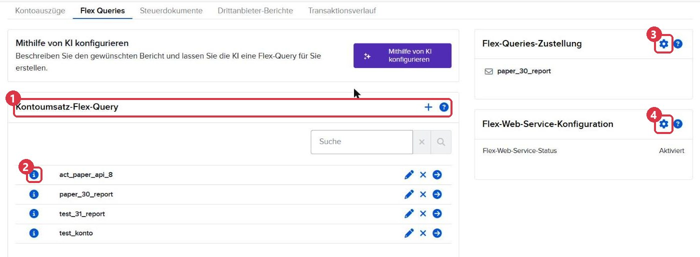

| Nr. | Element | Wofür |
|---|---|---|
| 1 | **Kontoumsatz-Flex-Query** mit **+** | neue Flex Query anlegen (Abschnitt 2) |
| 2 | **ⓘ** vor einer Query | Detailansicht mit der Query-ID (Abschnitt 3) |
| 3 | Zahnrad bei **Flex-Queries-Zustellung** | tägliche Zustellung per E-Mail (Abschnitt 4) |
| 4 | Zahnrad bei **Flex-Web-Service-Konfiguration** | Prüfcode für den Abruf per Web-API (Abschnitt 5) |

Der Reiter **Kontoauszüge** links daneben wird in Abschnitt 6 gebraucht.

## 2. Flex Query für die Trades anlegen

Über das **+** bei *Kontoumsatz-Flex-Query* eine neue Query anlegen (auf Englisch heißt sie
*Activity Flex Query*). Der Name ist frei wählbar, z. B. `money_report`.

**Abschnitte** — genau diese drei auswählen (aktivierte Abschnitte erscheinen blau mit Haken):

- **Trades**
- **Optionsausübungen, -zuteilungen und -fälligkeiten**
- **Kapitalmaßnahmen**

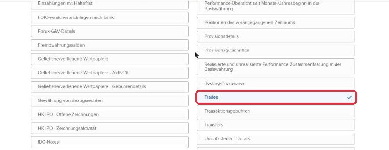

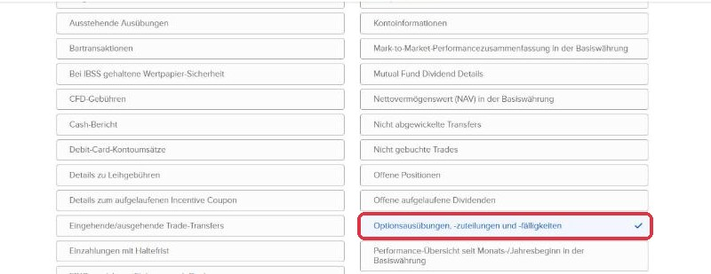

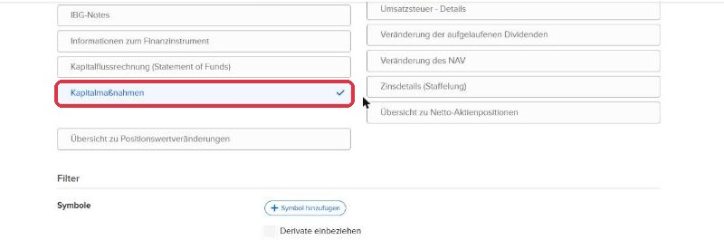

> [!WARNING]
> Ohne *Optionsausübungen, -zuteilungen und -fälligkeiten* bleiben verfallene oder zugeteilte
> Optionen im Journal dauerhaft offen; ohne *Kapitalmaßnahmen* werden Aktiensplits nicht
> berücksichtigt.

Beim Anklicken eines Abschnitts öffnet sich ein Fenster mit **Optionen** und der **Feldauswahl**.
In allen drei Abschnitten **„Alle auswählen“** anhaken — dann fehlt garantiert kein Feld, das
der Import braucht.

**Trades:** unter *Optionen* nur **Ausführung** (1), dann **Alle auswählen** (2).

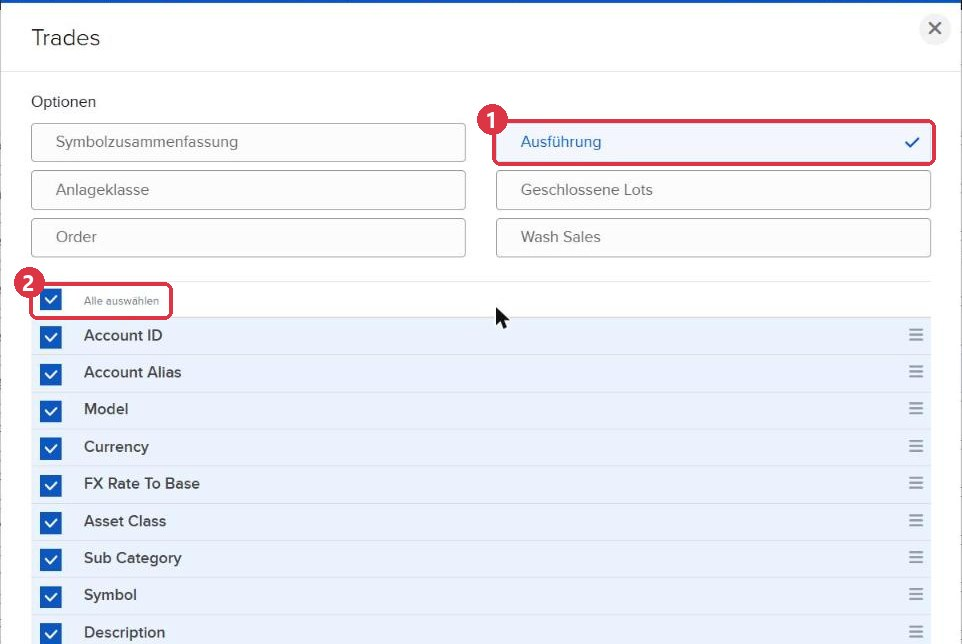

**Optionsausübungen, -zuteilungen und -fälligkeiten:** keine Optionen, nur **Alle auswählen**.

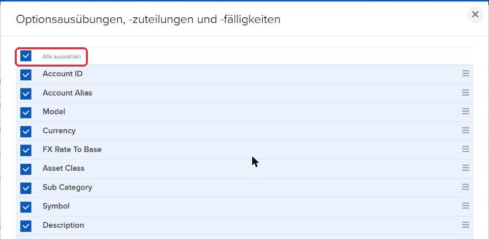

**Kapitalmaßnahmen:** unter *Optionen* nur **Detail** (1), dann **Alle auswählen** (2).

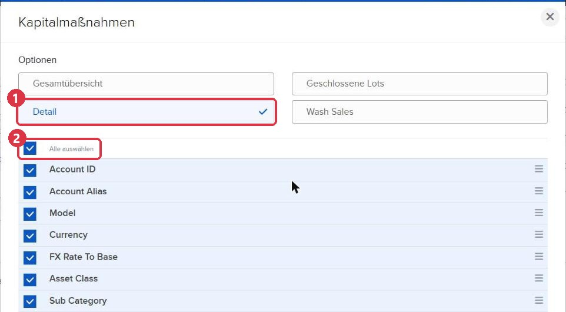

**Zustellungskonfiguration** — weiter unten im Formular:

| Einstellung | Wert |
|---|---|
| Format | **XML** |
| Zeitraum | **Letzte n Kalendertage** |
| Anzahl der Tage | **8** |

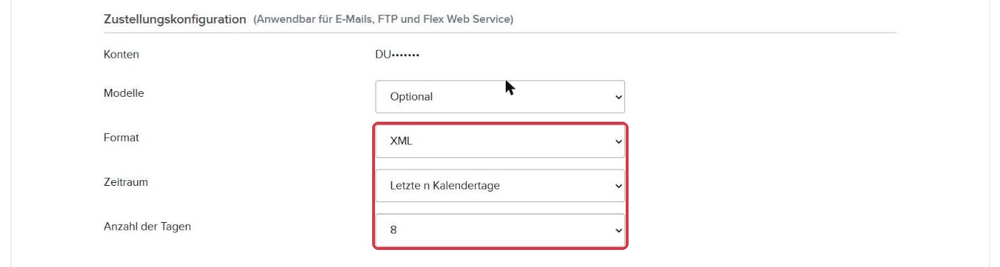

Der Zeitraum von acht Tagen ist bewusst überlappend: Fällt ein Bericht aus (Feiertag,
Mail-Problem, Rechner aus), holt der nächste die fehlenden Tage nach. Doppelt gelieferte Trades
erkennt der Import und überspringt sie.

**Allgemeine Konfiguration:**

| Einstellung | Wert |
|---|---|
| Datumsformat | **dd/MM/yyyy** |
| Zeitformat | **HHmmss** |
| Datum/Uhrzeit-Trennzeichen | **; (Semikolon)** |
| Gewinn und Verlust | Standard |
| Include Offsetting Trade/Cancel Pairs? | Nein |
| Wechselkurse miteinbeziehen? | Nein |
| Prüfpfadfelder einbeziehen? | Ja |
| Konto-Pseudonym anstelle der Konto-ID anzeigen? | **Nein** |
| Aufschlüsselung nach Tagen? | Ja |

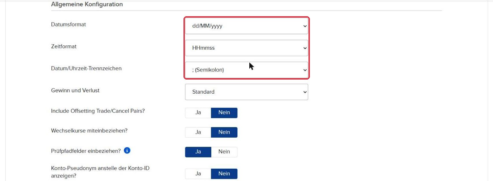

> [!IMPORTANT]
> Datumsformat, Zeitformat und Trennzeichen sind **Pflicht** in genau dieser Kombination
> (`23/09/2025;102924`). Mit einem anderen Format kann der Import Datum und Uhrzeit der Trades
> nicht lesen.

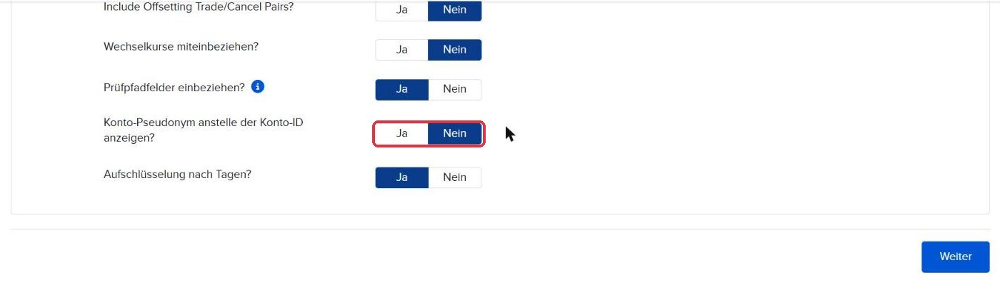

Das Konto-Pseudonym muss auf **Nein** stehen: Der Import ordnet jeden Bericht über die
Kontonummer (die letzten vier Ziffern) einem Benutzer und Environment zu.

Mit **Weiter** erscheint eine Prüfseite mit allen Einstellungen. Dort mit **Speichern** (bei
einer bestehenden Query: **Änderungen speichern**) abschließen.

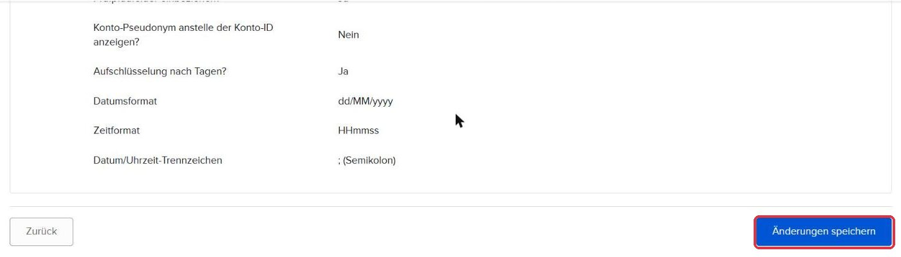

## 3. Query-ID finden

Jede Flex Query hat eine Nummer, die **Query-ID**. Sie wird für den Abruf per Web-API gebraucht
(Abschnitt 5). Zu finden ist sie über das **ⓘ** vor der Query in der Übersicht — die
Detailansicht zeigt sie ganz oben unter *Details zu Kontoumsatz-Flex-Queries*.

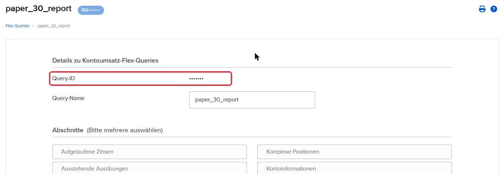

## 4. Tägliche Zustellung per E-Mail

In der Übersicht beim Kasten **Flex-Queries-Zustellung** auf das Zahnrad klicken (Abschnitt 1,
Nr. 3) und auf der folgenden Seite beim Abschnitt **Zustellung von Umsatz-Flex-Queries** erneut
auf das Zahnrad.

- **Zustellungsmethode:** E-Mail (1)
- **Verschlüsselung:** Nein
- **Berichte:** die Query aus Abschnitt 2 anhaken, Format **XML** (2)

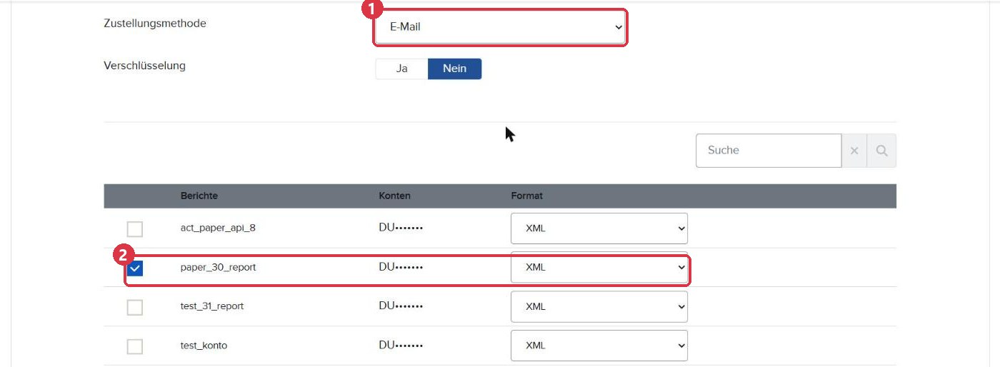

Mit **Weiter** und **Speichern** abschließen. Danach schickt IBKR den Bericht täglich per
E-Mail (Betreff beginnt mit *Activity Flex for …*).

> [!WARNING]
> IBKR schickt die Berichte **immer an die E-Mail-Adresse, die beim Anlegen des Kontos
> hinterlegt wurde** — eine eigene Empfängeradresse nur für Berichte gibt es nicht. Das Postfach,
> das der Abruf in `xml_proj` liest (`IMAP_USERNAME`), muss also diese Adresse sein oder die
> Mails dorthin weiterleiten. Bei einer Weiterleitung muss der Absender
> `donotreply@interactivebrokers.com` erhalten bleiben — der Abruf filtert danach.

## 5. Abruf per Web-API (optional)

Der Abruf per Web-API ist ein zweiter, unabhängiger Weg zu denselben Daten — nützlich, falls an
einem Tag keine Mail ankommt. Dafür braucht es zwei Dinge: eine eigene Flex Query und einen
Prüfcode.

**Eigene Query:** eine zweite Flex Query anlegen, **mit genau denselben Einstellungen** wie in
Abschnitt 2 (z. B. Name `act_money_api`). Diese Query wird **nicht** für die E-Mail-Zustellung
angehakt — sie wird nur abgerufen. Ihre Query-ID wie in Abschnitt 3 ablesen.

**Prüfcode:** In der Übersicht beim Kasten **Flex-Web-Service-Konfiguration** auf das Zahnrad
klicken (Abschnitt 1, Nr. 4). IBKR nennt den Zugangsschlüssel **Prüfcode** (englisch *Token*).

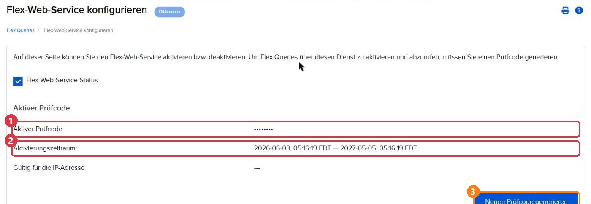

| Nr. | Element | Bedeutung |
|---|---|---|
| — | **Flex-Web-Service-Status** | muss angehakt sein |
| 1 | **Aktiver Prüfcode** | der Schlüssel für `xml_proj` |
| 2 | **Aktivierungszeitraum** | Gültigkeit — rund **ein Jahr** |
| 3 | **Neuen Prüfcode generieren** | erzeugt einen neuen Schlüssel, der alte wird **sofort ungültig** |

Gibt es noch keinen Prüfcode, wird er mit *Neuen Prüfcode generieren* erstellt. In
`xml_proj/.env` werden Prüfcode und Query-ID als Paar eingetragen:

```
IBKR_FLEX_QUERIES=Prüfcode:Query-ID
```

Mehrere Konten bzw. Queries werden durch Kommas getrennt (`Prüfcode1:QueryID1,Prüfcode2:QueryID2`).

> [!WARNING]
> Der Prüfcode **läuft nach rund einem Jahr ab**. Danach scheitert der Web-API-Abruf, bis ein
> neuer Prüfcode erzeugt und in der `.env` eingetragen ist — das Ablaufdatum am besten im
> Kalender notieren. *Neuen Prüfcode generieren* nur dann klicken, wenn der alte abgelaufen
> oder kompromittiert ist. Außerdem: Viele fehlgeschlagene Abrufe kurz hintereinander können zu
> einer vorübergehenden Sperre durch IBKR führen.

> [!CAUTION]
> Der Prüfcode ist ein Zugangsschlüssel zu den Kontodaten. Er gehört nur in die `.env` (die nie
> committet wird) — nicht in Screenshots, Chats oder Support-Anfragen.

## 6. Kontoauszug (CSV) für Kontostand und Rendite

Die Tageswerte des Kontos — Nettovermögen, Cash, Tagesrendite — liefert IBKR **nicht** über Flex
Queries, sondern nur im Kontoauszug, und den **nur per E-Mail**. Dafür wird ein
benutzerdefinierter Kontoauszug angelegt.

Im Menü **Performance & Berichte** den Reiter **Kontoauszüge** öffnen. Unten im Abschnitt
**Benutzerdefinierte Kontoauszüge** einen neuen Kontoauszug anlegen, Kontoauszugstyp
**Kontoauszug**.

**Abschnitte** — diese fünf werden vom Import gelesen und sind Pflicht:

- **Kontoinformationen**
- **Nettovermögenswert**
- **Cash-Bericht**
- **Übersicht: realisierter & unrealisierter G&V**
- **Übersicht Monats- & Jahresbeginn bis heute**

Weitere Abschnitte stören nicht. Die Bilder zeigen eine funktionierende Auswahl, die zusätzlich
u. a. *Trades*, *Kapitalmaßnahmen*, *MTM-Performance-Übersicht* und *Transaktionsgebühren* enthält.

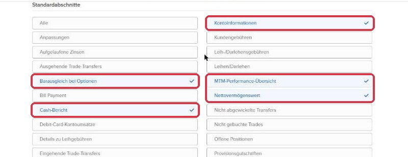

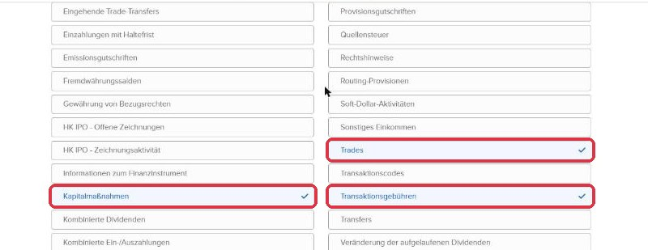

**Einstellungen und Zustellungskonfiguration** am Ende des Formulars:

| Einstellung | Wert |
|---|---|
| Konto-ID durch Konto-Pseudonym ersetzen? | **Nein** (1) |
| Format | **CSV** (2) |
| Zeitraum | **Täglich** (2) |
| Sprache | **English** (2) |

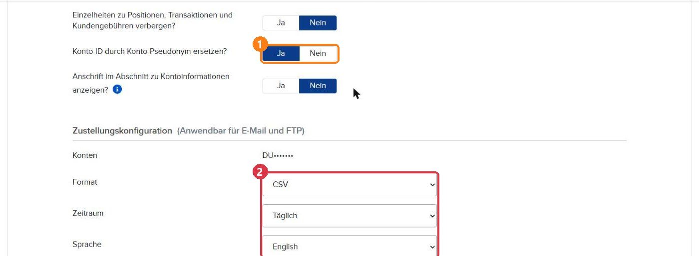

> [!IMPORTANT]
> Die **Sprache muss English sein**: Der Import erkennt die Abschnitte und Zeilen an ihren
> englischen Bezeichnungen (z. B. *Net Asset Value*, *Ending Cash*).

> [!NOTE]
> Im Bild steht das Pseudonym (1) auf *Ja*. Das funktioniert nur, solange für das Konto kein
> Pseudonym vergeben ist — dann setzt IBKR die teilweise maskierte Kontonummer ein. **Nein** ist
> die sichere Wahl.

**Zustellung:** zurück im Reiter **Kontoauszüge** rechts beim Kasten **Zustellung der
Kontoauszüge** auf das Zahnrad klicken.

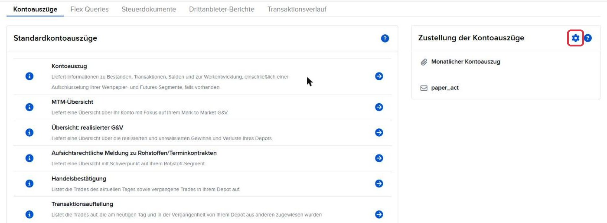

Im Abschnitt **Zustellung von täglichen, benutzerdefinierten Auszügen** über das Zahnrad
Zustellungsmethode **E-Mail** wählen und den neuen Kontoauszug mit Format **CSV** anhaken — wie
bei der Flex Query in Abschnitt 4.

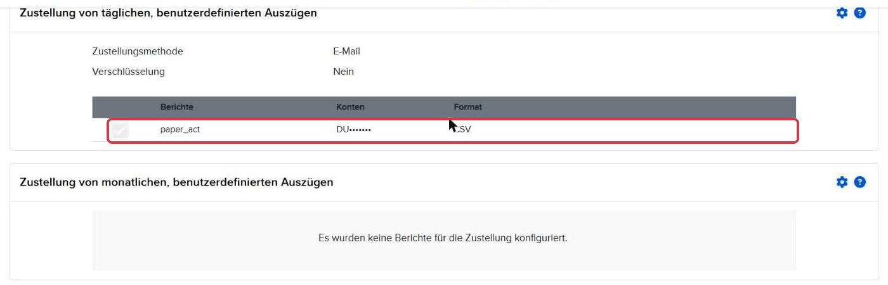

Die Mail kommt an dieselbe Konto-Adresse wie die Flex Query (Betreff *Activity Statement* bzw.
*Kontoauszug*). Die Standard-Kontoauszüge oben auf der Seite (täglich, monatlich) sind für das
Journal nicht nötig.

## 7. Zusammenfassung: was wohin gehört

| Aus dem Kundenportal | Eintrag in `xml_proj` |
|---|---|
| E-Mail-Adresse des Kontos (bzw. Postfach mit Weiterleitung) | `.env`: `IMAP_USERNAME`, `IMAP_PASSWORD`, `IMAP_SERVER` |
| Prüfcode + Query-ID der Web-API-Query | `.env`: `IBKR_FLEX_QUERIES=Prüfcode:Query-ID` |
| Kontonummer (letzte vier Ziffern) | `accounts.toml`: Zuordnung zu Benutzer und Environment |

**Checkliste je Konto:**

1. Flex Query mit *Trades*, *Optionsausübungen, -zuteilungen und -fälligkeiten*, *Kapitalmaßnahmen* — jeweils *Alle auswählen*
2. XML, letzte 8 Kalendertage, `dd/MM/yyyy` · `HHmmss` · `;`, Pseudonym *Nein*
3. Flex Query für die tägliche E-Mail-Zustellung angehakt
4. *(optional)* zweite, gleich eingestellte Query + Prüfcode für die Web-API, Ablaufdatum notiert
5. Benutzerdefinierter Kontoauszug: fünf Pflicht-Abschnitte, CSV, täglich, English, Pseudonym *Nein*
6. Kontoauszug für die tägliche E-Mail-Zustellung angehakt
7. Kontonummer in `accounts.toml` eingetragen
