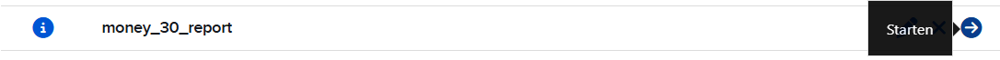
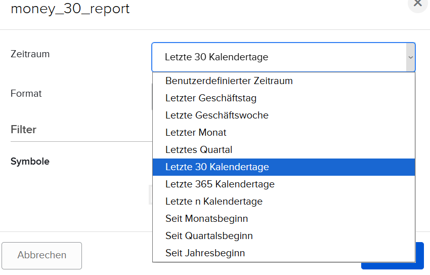
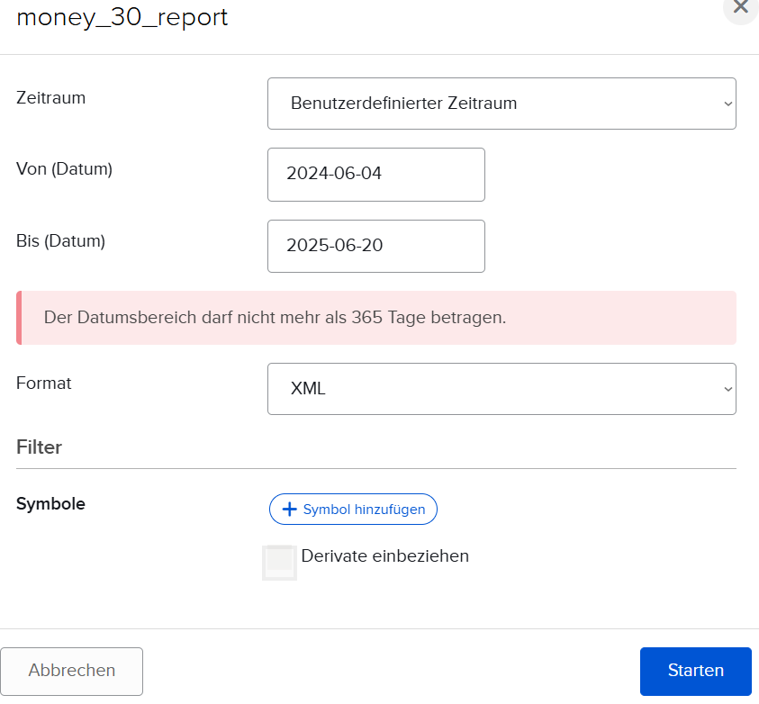
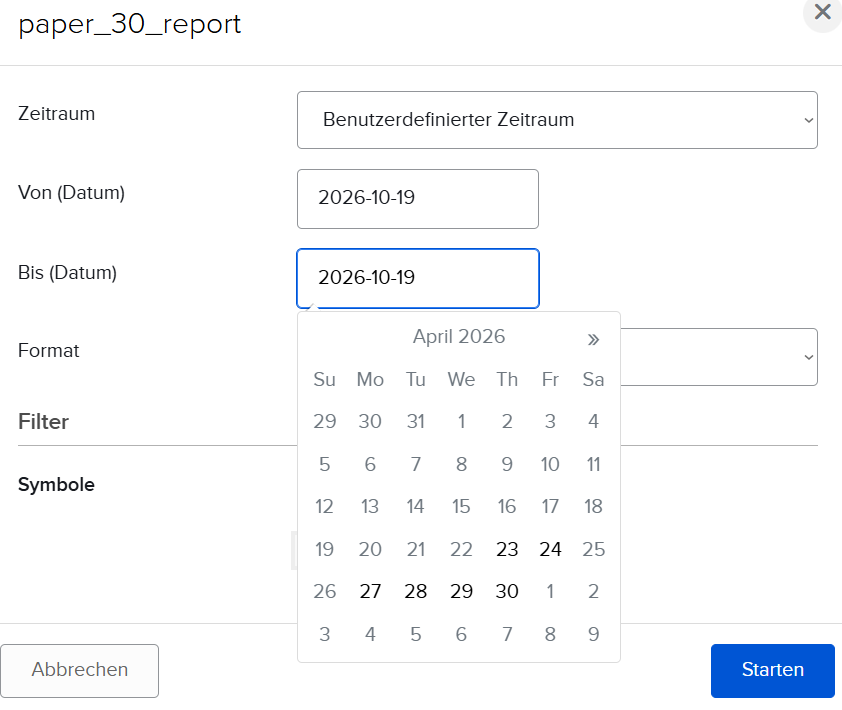

# TradingJournal-Weaver installieren

Diese Anleitung richtet die Datenimport-Pipeline (`TradingJournal-Weaver`) auf einem Rechner ein — sie
holt die Handelsdaten von Interactive Brokers und verarbeitet sie für das Trading-Journal.
Schritt für Schritt, mit Erklärungen, auch wenn du bisher wenig Erfahrung mit
Terminal-Befehlen oder Python hast. Es gibt dazu auch eine kürzere, technischere Version:
[Technisches Handbuch: Installation: TradingJournal-Weaver](../technik/50-installation-weaver.md). Beide führen zum selben Ergebnis.

**Bevor du hier startest:** Die Grundausstattung (Git, Python, XAMPP, ...) muss bereits
installiert sein — siehe [Windows vorbereiten](30-windows-vorbereiten.md).

---

## Inhalt

1. [Projekt herunterladen](#1-projekt-herunterladen)
2. [Python-Arbeitsumgebung einrichten](#2-python-arbeitsumgebung-einrichten)
3. [Konfigurationsdatei anlegen](#3-konfigurationsdatei-anlegen)
4. [Datenbank-Tabellen anlegen](#4-datenbank-tabellen-anlegen)
5. [Automatisierung einrichten](#5-automatisierung-einrichten)
6. [Ersten Testlauf machen](#6-ersten-testlauf-machen)
7. [Praktisch: Schnellzugriff einrichten](#7-praktisch-schnellzugriff-einrichten)
8. [Alte Daten nachholen (einmalig)](#8-alte-daten-nachholen-einmalig)

---

## 1. Projekt herunterladen

Ein PowerShell-Fenster öffnen (Windows-Taste drücken, `PowerShell` eintippen, Enter) und in
den Ordner wechseln, in dem die anderen Projekte schon liegen bzw. liegen sollen (z.B.
`C:\Users\<dein Name>\trading`):

```powershell
cd C:\Users\<dein Name>\trading
```

Falls `TradingJournal-Weaver` dort noch nicht liegt, herunterladen ("klonen"):

```powershell
git clone https://github.com/mike-1140/TradingJournal-Weaver.git
cd TradingJournal-Weaver
```

---

## 2. Python-Arbeitsumgebung einrichten

Python-Projekte arbeiten normalerweise mit einer eigenen, abgeschotteten "Arbeitsumgebung"
(venv — kurz für *virtual environment*) pro Projekt. Das verhindert, dass sich verschiedene
Python-Projekte auf demselben Rechner gegenseitig mit unterschiedlichen Versionen von
Zusatz-Paketen in die Quere kommen. Drei Befehle, nacheinander:

```powershell
python -m venv .venv
.venv\Scripts\activate
pip install -r requirements.txt
```

Der zweite Befehl "aktiviert" die Arbeitsumgebung für dieses Terminal-Fenster — am
vorangestellten `(.venv)` im Prompt erkennbar. Der dritte lädt alle Zusatz-Pakete herunter,
die `TradingJournal-Weaver` braucht (kann ein bis zwei Minuten dauern).

**Wichtig:** Die Aktivierung (`.venv\Scripts\activate`) gilt nur für das aktuell offene
Terminal-Fenster. Bei jedem neuen Fenster muss man diesen einen Befehl wiederholen — dafür
gibt es aber eine Abkürzung, siehe Schritt 7.

---

## 3. Konfigurationsdatei anlegen

Wie beim Trading-Journal selbst braucht auch `TradingJournal-Weaver` eine `.env`-Datei mit den eigenen
Zugangsdaten. Vorlage kopieren:

```powershell
copy .env.example .env
```

Jetzt die neue Datei `.env` im `TradingJournal-Weaver`-Ordner mit einem Text-Editor öffnen (Rechtsklick →
**Öffnen mit** → **Editor**). Folgende Werte eintragen bzw. anpassen:

| Zeile in `.env` | Was dort rein muss |
|---|---|
| `DB_USER=` | `root` (XAMPP-Standard) |
| `DB_PASS=` | leer lassen, falls kein XAMPP-Datenbank-Passwort vergeben wurde |
| `DEFAULT_USER=` | der eigene Name, z.B. `anna` — dazu gleich mehr |
| `IMAP_USERNAME=` | das Postfach, an das IBKR die Berichte schickt (Kapitel [IBKR einrichten](20-ibkr-einrichten.md), Abschnitt 4) |
| `IMAP_PASSWORD=` | das Passwort dieses Postfachs |
| `IMAP_SERVER=` | der Posteingangs-Server (IMAP) des Mailanbieters, z.B. `imap.gmx.com` |
| `IBKR_FLEX_QUERIES=` | nur für den Abruf per Web-API: Prüfcode und Query-ID als Paar (Kapitel [IBKR einrichten](20-ibkr-einrichten.md), Abschnitt 5) — sonst leer lassen |

**Was hat es mit `DEFAULT_USER` auf sich?** Falls mehrere Personen dasselbe Trading-Journal
nutzen (z.B. eine Familie), bekommt jede Person ihre eigenen Datenbank-Tabellen mit einem
eigenen "Präfix" (einer Art Namens-Kürzel vor jedem Tabellennamen, z.B. `anna_trades_raw`).
Welches Präfix zu welchem Namen gehört, steht zentral in der Datei `users.toml`. Auch sie wird
aus einer Vorlage angelegt (`copy users.toml.example users.toml`) und dann um die eigenen Namen
ergänzt — Beispiel unten. `DEFAULT_USER` ist der Hauptbenutzer dieses Rechners — sein
Präfix gilt, wenn ein Befehl ohne ausdrückliche Benutzerangabe läuft. Der tägliche automatische
Lauf verarbeitet dagegen alle Benutzer, die in `pipeline.toml` stehen (Schritt 5).

**Welches IBKR-Konto zu wem gehört**, steht in einer dritten Datei, `accounts.toml`. Sie wird
ebenfalls aus einer Vorlage angelegt:

```powershell
copy accounts.toml.example accounts.toml
```

Ohne passenden Eintrag dort überspringt der Import die Berichte eines Kontos (Meldung „Unbekannte
accountId“). Als Schlüssel dienen die **letzten vier Ziffern der IBKR-Kontonummer**.

### Beispiel: Anna und Tom

Anna und Tom nutzen das Journal gemeinsam auf Annas Rechner. Anna hat ein Echtgeld-Konto
(Kontonummer endet auf `1234`) und ein Paper-Konto (`5678`), Tom nur ein Paper-Konto (`9012`).

**Text-Editor, Datei `users.toml`** — beide Namen mit ihrem Präfix:

```toml
[anna]
prefix = "anna_"

[tom]
prefix = "tom_"
```

**Text-Editor, Datei `accounts.toml`** — jedes Konto einem Namen und einem Environment
zuordnen:

```toml
[1234]
user = "anna"
environment = "money"

[5678]
user = "anna"
environment = "paper"

[9012]
user = "tom"
environment = "paper"
```

**Text-Editor, Datei `.env`** — die wichtigen Zeilen (alle anderen bleiben wie in der Vorlage):

```ini
DB_USER=root
DB_PASS=

DEFAULT_USER=anna

IMAP_USERNAME=anna@example.com
IMAP_PASSWORD=Passwort-von-Annas-Postfach
IMAP_SERVER=imap.gmx.com

IBKR_FLEX_QUERIES=PrüfcodeAnna:QueryIdAnnaMoney,PrüfcodeAnna:QueryIdAnnaPaper,PrüfcodeTom:QueryIdTomPaper
```

> [!NOTE]
> `TradingJournal-Weaver` liest **ein** Postfach. IBKR schickt Toms Berichte aber an die
> E-Mail-Adresse seines eigenen IBKR-Kontos — Tom richtet deshalb in seinem Mailprogramm eine
> **Weiterleitung** der IBKR-Mails an Annas Postfach ein (der Absender
> `donotreply@interactivebrokers.com` muss dabei erhalten bleiben). Über die Web-API ist das
> nicht nötig: Dort stehen einfach alle Prüfcode/Query-ID-Paare hintereinander.

Die Präfixe aus `users.toml` werden später auch für die Benutzerkonten der Weboberfläche
gebraucht (Kapitel [TradingJournal installieren](50-tradingjournal-installieren.md)) — dort
muss für Anna `anna_` und für Tom `tom_` stehen.

**Sicherheit:** Die Dateien `.env` und `accounts.toml` enthalten Zugangsdaten bzw. Kontodaten und
werden **niemals** mit hochgeladen (automatisch ausgeschlossen) — das ist so gewollt, nicht
anfassen.

---

## 4. Datenbank-Tabellen anlegen

Dieser Befehl legt die eigentlichen Datenbank-Tabellen an, in denen später die Handelsdaten
landen. **Wichtig:** Läuft man ihn ein zweites Mal für dieselbe Kombination, werden
bestehende Daten dort gelöscht und neu angelegt — beim allerersten Setup aber genau richtig.

Den eigenen Namen (aus Schritt 3, mit Unterstrich am Ende) einsetzen. **`test` immer
anlegen** — die Weboberfläche startet in diesem Bereich, und er dient zum gefahrlosen
Ausprobieren. Dazu die Environments für die eigenen IBKR-Konten, z. B. `money` für den
Echtgeld-Bereich:

```powershell
python -m tools.maintenance.reset_IBKR_DB test dein_name_
python -m tools.maintenance.reset_IBKR_DB money dein_name_
```

Für weitere Environments (z.B. zusätzlich Paper-Trading) den Befehl mit dem jeweils anderen
Environment-Namen wiederholen:

```powershell
python -m tools.maintenance.reset_IBKR_DB paper dein_name_
```

**Beispiel Anna und Tom** — beide bekommen *test*, dazu Anna *money* und *paper*, Tom nur
*paper*:

```powershell
python -m tools.maintenance.reset_IBKR_DB test anna_
python -m tools.maintenance.reset_IBKR_DB money anna_
python -m tools.maintenance.reset_IBKR_DB paper anna_
python -m tools.maintenance.reset_IBKR_DB test tom_
python -m tools.maintenance.reset_IBKR_DB paper tom_
```

---

## 5. Automatisierung einrichten

`TradingJournal-Weaver` kann die Datenverarbeitung automatisch für mehrere Personen/Environments auf
einmal erledigen — welche das auf **diesem** Rechner sind, steht in einer Datei namens
`pipeline.toml`, die noch nicht existiert. Aus einer Vorlage anlegen:

```powershell
copy pipeline.toml.example pipeline.toml
```

Jetzt `pipeline.toml` im Text-Editor öffnen und den Platzhalter-Abschnitt anpassen — eigenen
Namen (ohne Unterstrich) und die in Schritt 4 angelegten Environments eintragen:

```toml
[users.dein_name]
environments = ["money"]

[[test]]
user = "dein_name"
```

Das Test-Environment steht **nicht** in der Liste `environments`, sondern in einem eigenen
`[[test]]`-Block — die Vorlage enthält ihn schon, dort nur den Namen anpassen.

**Beispiel Anna und Tom** — die Environments aus Schritt 4, TEST je Person als eigener Block:

```toml
[users.anna]
environments = ["money", "paper"]

[users.tom]
environments = ["paper"]

[[test]]
user = "anna"

[[test]]
user = "tom"
```

Der `[[test]]`-Block schadet im Alltag nicht: TEST liest nur Dateien, die man selbst nach
`C:\Trade_XML\test\<benutzer>\incoming\` legt (siehe [Alltag mit dem
TradingJournal](70-alltag.md), Abschnitt „Wenn etwas nicht stimmt“), und wird für den Testlauf
in Schritt 6 gebraucht.

**Wichtig:** Hier nur Environments eintragen, für die Schritt 4 auch wirklich schon gelaufen
ist — sonst bricht die automatische Verarbeitung später mit einer Fehlermeldung ab, weil die
zugehörigen Tabellen fehlen.

---

## 6. Ersten Testlauf machen

Erst eine "Trockenübung", die nichts wirklich ausführt, nur zeigt was passieren würde:

```powershell
python run_pipeline.py --dry-run
```

Sieht das plausibel aus (die eigenen Environments aus Schritt 5 tauchen auf), ein echter
Testlauf — den eigenen Namen einsetzen:

```powershell
python run_pipeline.py --users dein_name --envs test
```

---

## 7. Praktisch: Schnellzugriff einrichten

Damit man beim nächsten Mal nicht wieder manuell in den Ordner wechseln und die
Arbeitsumgebung (Schritt 2) aktivieren muss, gibt es eine Desktop-Verknüpfung, die beides in
einem Doppelklick erledigt.

Einmalig einrichten — im PowerShell-Fenster, das noch im `TradingJournal-Weaver`-Ordner steht:
```powershell
. .\create-desktop-shortcut.ps1
```

**Falls eine Fehlermeldung mit den Worten "Ausführung von Skripts" oder "deaktiviert"
erscheint:** Windows blockiert auf frisch eingerichteten Rechnern zunächst das Ausführen
von `.ps1`-Dateien. Einmalig beheben — PowerShell **als Administrator** öffnen
(Windows-Taste → `PowerShell` eintippen → Rechtsklick auf den Treffer →
**"Als Administrator ausführen"**) und eintippen:
```powershell
Set-ExecutionPolicy -Scope CurrentUser -ExecutionPolicy RemoteSigned
```
Danach ein normales (nicht als Administrator geöffnetes) PowerShell-Fenster im
`TradingJournal-Weaver`-Ordner öffnen und den Befehl von oben nochmal ausführen.

Danach liegt auf dem Desktop eine Verknüpfung namens **"TradingJournal-Weaver Pipeline"**. Doppelklick
darauf öffnet PowerShell bereits im richtigen Ordner mit aktivierter Arbeitsumgebung — dort
dann direkt z.B. `python run_pipeline.py` eintippen.

---

## 8. Alte Daten nachholen (einmalig)

Der tägliche Bericht enthält nur die letzten Tage (siehe [IBKR einrichten — Flex Queries und
Kontoauszug](20-ibkr-einrichten.md), Abschnitt 2). Alles, was **vor** der Installation gehandelt
wurde, fehlt also zunächst im Journal — auch Positionen, die heute noch offen sind. Diese alten
Daten holst du **einmal** von Hand bei IBKR und legst sie dem ersten echten Lauf bei.

> [!IMPORTANT]
> **Alte Daten vor dem ersten echten Lauf einspielen** — bzw. spätestens im selben Lauf wie die
> ersten täglichen Berichte. Innerhalb eines Laufs ordnet `TradingJournal-Weaver` alle Trades
> chronologisch, egal in welcher Datei sie stehen. Kommen alte Trades dagegen erst **nach**
> neueren Trades dazu, die schon verarbeitet sind, stimmen Positionen und Kampagnen nicht mehr
> (Beispiel und Abhilfe: [Alltag mit dem TradingJournal](70-alltag.md), Abschnitt 1). Der Testlauf mit `--envs test` aus Schritt 6 ist unbedenklich, er berührt die echten
> Environments nicht.

**Schritt 1 — Bericht bei IBKR erzeugen** (im Browser, IBKR-Kundenportal):

1. **Performance & Berichte** → Reiter **Flex Queries** öffnen.
2. Bei der Flex Query für die E-Mail (aus Kapitel „IBKR einrichten“, Abschnitt 2) ganz rechts
   auf den Pfeil **Starten** (→) klicken.

   

3. Im folgenden Fenster bei **Zeitraum** den Eintrag **Benutzerdefinierter Zeitraum** wählen.
   Für genau das letzte Jahr geht auch **Letzte 365 Kalendertage**.

   

4. **Von (Datum)** und **Bis (Datum)** eintragen, **Format** auf **XML** lassen, den **Filter**
   leer lassen (sonst kommen nur einzelne Symbole) und auf **Starten** klicken. IBKR erstellt
   den Bericht, der Browser lädt ihn als `.xml`-Datei herunter.

   

Der Name der Query und der dort gespeicherte Zeitraum (z. B. 30 Tage) spielen dabei keine Rolle:
Der Name dient nur der Übersicht, und beim händischen Starten gilt der Zeitraum, den du jetzt
angibst. Die gespeicherte Query bleibt dabei unverändert.

> [!NOTE]
> **Wie weit es zurückgeht:**
> - Je Abruf sind höchstens **365 Tage** möglich. Bei einem längeren Bereich erscheint *Der
>   Datumsbereich darf nicht mehr als 365 Tage betragen* (siehe Bild). Für eine längere
>   Vorgeschichte den Abruf Jahr für Jahr wiederholen, z. B. 2024-01-01 bis 2024-12-31,
>   dann 2025-01-01 bis 2025-12-31 und so weiter. Mehrere Dateien sind kein Problem.
> - **Paper-Konten:** IBKR liefert nur die **letzten rund 180 Tage** (etwa 6 Monate). Ältere
>   Paper-Daten sind nicht mehr abrufbar — der Kalender lässt frühere Tage gar nicht erst
>   auswählen (siehe Bild unten).
> - **Echtgeld-Konten** reichen deutlich weiter zurück — IBKR stellt Kontodaten mehrere Jahre
>   online bereit. Ein Datum vor der Kontoeröffnung ist sinnlos; am einfachsten beim
>   Eröffnungsjahr beginnen.



> [!TIP]
> Überlappungen sind kein Problem: Liegt das Bis-Datum mitten in einem Zeitraum, den auch der
> tägliche Bericht liefert, erkennt der Import die doppelten Trades und überspringt sie. Lieber
> großzügig bis heute abrufen als eine Lücke lassen.

Das wiederholst du für **jedes Konto** (Echtgeld, Paper, …) — wie bei der Einrichtung im
Kundenportal des jeweiligen Kontos.

**Schritt 2 — Dateien ablegen** (im Windows-Explorer):

Alle heruntergeladenen `.xml`-Dateien in den Ordner **`C:\Trade_XML\incoming_mail`** kopieren.
Den Ordner legt `TradingJournal-Weaver` beim ersten Lauf selbst an; existiert er noch nicht, ihn
einfach anlegen. Der Dateiname ist egal, er muss nur auf `.xml` enden: Zu welchem Benutzer und
Environment eine Datei gehört, liest der Import aus der Kontonummer in der Datei. Die Kontonummer
muss deshalb in `accounts.toml` stehen (Schritt 3), sonst wird die Datei übersprungen.

**Schritt 3 — verarbeiten** (PowerShell im `TradingJournal-Weaver`-Ordner mit aktivierter
Arbeitsumgebung, z. B. über die Verknüpfung aus Schritt 7):

```powershell
python run_pipeline.py
```

Das ist der normale Lauf: Er holt zusätzlich die aktuellen Berichte aus dem Postfach und
verarbeitet alles zusammen in der richtigen Reihenfolge. Danach liegen die Dateien nicht mehr in
`incoming_mail`, sondern in `C:\Trade_XML\<environment>\<benutzer>\processed` (bzw. `deleted`,
wenn eine Datei keine neuen Trades enthielt), und die alten
Trades sind im Journal sichtbar.

**Und die Kontostände?** Die Schritte oben holen nur die **Trades** nach (inkl. Verfall/Zuteilung
von Optionen und Splits). Gewinn/Verlust, Kampagnen und Statistiken reichen damit so weit zurück
wie die nachgeholten Trades. Die Kontostände (NAV, Cash, TWRR) kommen dagegen nur aus dem
**täglichen** Kontoauszug (CSV) — und der lässt sich nur **Tag für Tag** nachholen:

- Im Kundenportal unter **Performance & Berichte** → **Kontoauszüge** beim eigenen,
  benutzerdefinierten Kontoauszug (aus Kapitel „IBKR einrichten“, Abschnitt 6) als Zeitraum
  **Täglich** wählen, ein **Datum** eintragen und **CSV herunterladen**.
- Die Datei nach **`C:\Trade_CSV\incoming`** kopieren — der Dateiname ist egal, die Zuordnung
  läuft auch hier über die Kontonummer in der Datei. Der nächste Lauf liest sie ein; die
  Reihenfolge der Tage spielt keine Rolle.
- Für jeden Tag ein eigener Download — für ein ganzes Jahr wären das rund 250. Sinnvoll ist das
  daher eher für ein paar Tage, z. B. um eine Lücke zu schließen. Beim **Paper-Konto** gilt
  dieselbe Grenze wie oben: höchstens die letzten rund 180 Tage.

> [!NOTE]
> Ein **Monats- oder Jahreskontoauszug** bzw. ein Kontoauszug mit *Benutzerdefiniertem
> Zeitraum* hilft nicht: Er fasst einen ganzen Zeitraum zusammen statt einen Tag. Der Import
> meldet *Kein Datum im CSV — übersprungen* und lässt die Datei in `incoming` liegen — dort
> einfach löschen. Wer auf die Kontostände der Vergangenheit verzichtet, verliert nur den
> Anfang von NAV-Verlauf, TWRR und Max Drawdown; der Kontoauszug ist ohnehin optional, siehe
> [IBKR einrichten — Flex Queries und Kontoauszug](20-ibkr-einrichten.md), Abschnitt 6.

---

## Zusammenfassung — künftig starten

Nach der Ersteinrichtung, für den täglichen Gebrauch:

1. Doppelklick auf die Desktop-Verknüpfung "TradingJournal-Weaver Pipeline" (siehe Schritt 7)
2. Darin eintippen: `python run_pipeline.py`

---

## Weiterführende Dokumentation

| Datei | Inhalt |
|---|---|
| [Technisches Handbuch: Installation: TradingJournal-Weaver](../technik/50-installation-weaver.md) | Dieselben Schritte, technischer/kompakter |
| `docs/handbuch/technik/30-befehlsreferenz.md` (im `TradingJournal-Weaver`-Ordner) | Vollständige Befehlsreferenz aller Scripts |
| [TradingJournal installieren](50-tradingjournal-installieren.md) | Einrichtung der Weboberfläche (nächster Schritt) |
